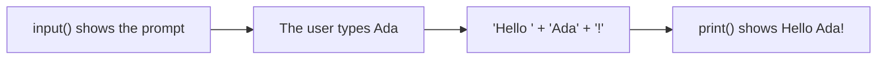
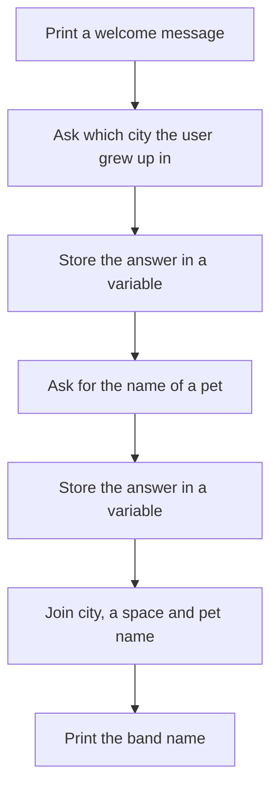

# Day 1 · Working with Variables in Python to Manage Data

[Roadmap](../../README.md#roadmap) · [Day 2 →](../Day%202%20-%20Beginner%20-%20Understanding%20Data%20Types%20and%20How%20to%20Manipulate%20Strings/Day%202%20-%20Beginner%20-%20Understanding%20Data%20Types%20and%20How%20to%20Manipulate%20Strings.md) <!-- nav -->

## TL;DR

- `print()` shows text in the console. Text inside quotes is a **string**; the quotes mark where it starts and ends.
- Strings join with `+` (**concatenation**), which adds no spaces of its own. `\n` inside a string starts a new line.
- `input(prompt)` pauses the program, shows the prompt and gives back whatever the user types, as a string.
- A **variable** gives a value a name so it can be reused: `city = input("Which city? ")`. Names use `snake_case`, are case-sensitive and cannot start with a digit.
- Error messages are clues: the last line names the error (`SyntaxError`, `IndentationError`, `NameError`) and the lines above it show where it happened.

## Learning objectives

By the end of this day you should be able to:

- Print text to the console with `print()`.
- Combine strings with `+` and split output over several lines with `\n`.
- Ask the user for data with `input()` and use the answer in the output.
- Store, reuse and reassign values with variables, following Python's naming rules.
- Read an error message and fix a `SyntaxError`, an `IndentationError` and a `NameError`.
- Add comments with `#` and switch lines of code on and off by commenting them.
- Build a small interactive program: the Band Name Generator.

## Lessons

### Course orientation (lectures 1-5)

The course is built around the #100DaysOfCode challenge: every day introduces new concepts and ends with a project, and each day is designed to take under two hours. No previous programming experience is assumed.

Two rules help to stay on track:

1. **Commit** to coding for at least an hour a day for 100 days. The course provides a printable pledge for this.
2. **Log progress** publicly, for example by posting each day with the #100DaysOfCode hashtag.

Tips for getting the most out of the lessons:

- Code along on a second screen instead of only watching. Programming is a practical skill.
- Keep the course's Python syntax cheat sheet at hand during the coding exercises.
- Write down how each new piece of code works while it is still fresh. Understanding matters more than memorising; syntax can always be looked up.
- Celebrate each finished day, for example by ticking it off a 100-day chart.

The course's *12 Rules to Learn to Code* eBook adds habits that are useful from the first day:

- **Start with 20 minutes.** A small task is easy to begin, and once started it is easy to keep going.
- **Keep a streak.** Marking every study day on a calendar builds a line that is motivating not to break.
- **Understand what you type.** Copying code without understanding it teaches very little.
- **Looking things up is normal.** Professionals search documentation and Q&A sites all the time; the skill is asking good questions and understanding the answers.
- **Step away from a stubborn bug.** A walk or a night's sleep often reveals the fix.
- **Break big problems into small chunks** that can each be solved on their own.

Lecture 4 previews the day's project, the Band Name Generator, and lists what it needs: printing, input, comments, debugging, string manipulation and variables. Lecture 5 sets up PyCharm and the course's exercise project; local setup comes back in depth on Day 15.

### 6. Printing to the Console in Python

`print()` is a **function**: a name followed by parentheses, with the thing to print inside the parentheses.

```python
print("Hello world!")
```

```text
Hello world!
```

The quotes tell Python that `Hello world!` is text, not code. A piece of text like this is a **string**, a sequence of characters, like beads on a string. Double quotes (`"..."`) and single quotes (`'...'`) both work as long as the opening and closing quotes match.

When PyCharm runs a file, the console shows three things:

1. The path of the Python interpreter and of the file that ran.
2. The program's output.
3. `Process finished with exit code 0`, which means the program ended without errors.

Errors are clues. Removing the closing quote breaks the program:

```python
print("Hello world!)
```

```text
  File "main.py", line 1
    print("Hello world!)
          ^
SyntaxError: unterminated string literal (detected at line 1)
```

A `SyntaxError` means the code breaks Python's grammar rules. Three habits help to fix it:

- **Watch the colours.** Syntax highlighting colours strings differently from code. If the closing parenthesis takes on the string colour, a quote is missing.
- **Read the caret (`^`).** It points to where Python got confused.
- **Search the error message.** Pasting the last line of the error into a search engine usually leads to an explanation, often on Stack Overflow.

PyCharm also checks code while it is typed: a red underline marks an error, a yellow one a warning. Many warnings come from [PEP 8](../../concepts/pep-8.md), the style guide for Python code, such as the rule that a file ends with a newline. Editor and AI hints only help once the code itself is understood; accepting a suggested fix blindly can create new problems.

### 7. String Manipulation and Code Intelligence

`\n` inside a string is replaced by a line break, so one `print()` can produce several lines. It is a backslash (`\`), not a forward slash (`/`).

```python
print("Hello world!\nHello world!\nHello world!")
```

```text
Hello world!
Hello world!
Hello world!
```

A space typed right after `\n` ends up at the start of the next line.

**Concatenation** joins strings end to end with `+`. Python adds nothing in between, so any space has to be part of one of the strings:

```python
print("Hello" + "Ada")        # HelloAda
print("Hello " + "Ada")       # Hello Ada
print("Hello" + " " + "Ada")  # Hello Ada
```

Spaces inside a string are just text, but spaces in the code itself can change its meaning. A space at the start of a line is an error:

```python
 print("Hello world!")
```

```text
  File "main.py", line 1
    print("Hello world!")
IndentationError: unexpected indent
```

Indentation has a meaning in Python that later days rely on (covered on Day 3 with `if` statements). Other spacing is allowed but flagged as bad style, such as a space between `print` and `(`.

Editor warnings differ from one editor to another, while error messages come from Python itself and look the same everywhere. That makes reading the error printed after running the code the most useful debugging skill.

The word **debugging** is linked to a famous logbook entry from 1947: engineers working on the Harvard Mark II computer found a moth stuck in a relay and taped it into the log as the "first actual case of bug being found". Today debugging means finding and removing the causes of errors in code.

### 8. The Python Input Function

`input()` asks the user for data. The text inside the parentheses is the **prompt**:

```python
input("What is your name? ")
```

When Python reaches `input()`, the program pauses (PyCharm shows a stop button instead of finishing), shows the prompt and waits. Once the user types an answer and presses Enter, the whole `input(...)` call is replaced by the typed text, always as a string.

So `input()` can go anywhere a string can, even inside `print()`:

```python
print("Hello " + input("What is your name? ") + "!")
```

```text
What is your name? Ada
Hello Ada!
```

Python works from the inside out: it needs the value inside `print()`'s parentheses before it can print it.



The free editor [Thonny](https://thonny.org) can show this step by step: its debugger has a **Step into** button that highlights each part of the line as Python evaluates it.

**Comments** start with `#`. Python ignores everything from `#` to the end of the line, which makes comments a good place for notes in one's own words:

```python
# input() runs first, then the strings are joined, then print() shows the result.
print("Hello " + input("What is your name? ") + "!")
```

In most editors, `Ctrl + /` (`Cmd + /` on macOS) comments out the selected lines, and pressing it again turns them back into code. This switches code off without deleting it.

### 9. Python Variables

Without a name, the answer from `input()` is used once and lost. A **variable** stores a value under a name so it can be used again later:

```python
name = input("What is your name? ")
print(name)
```

The `=` sign is **assignment**: store the value on the right under the name on the left. It is not the equals sign from maths. Assigning again replaces the value:

```python
name = "Jack"
print(name)
name = "Ada"
print(name)
```

```text
Jack
Ada
```

A variable is like a labelled box: the name is the label and the value is what is inside. Code refers to the label, so the same line works with whatever value the box holds, including anything the user types.

A variable can also hold the result of a function. `len()` counts the characters in a string:

```python
name = input("What is your name? ")
length = len(name)
print(length)
```

```text
What is your name? Ada
3
```

### 10. Variable Naming

Python accepts almost any name, as long as the same spelling is used every time. The example above works just as well with `n` and `l` instead of `name` and `length`, but six months later those letters say nothing about what they hold. The most important rule is readability: choose names that describe the value.

On top of that, Python has strict rules for names:

| Rule | Valid | Invalid |
| --- | --- | --- |
| One single word: join words with underscores, never spaces | `user_name` | `user name`, `user-name` |
| Digits are allowed, but not at the start | `length1` | `1length` |
| Must not be a keyword | `class_name` | `class`, `if`, `for` |

Breaking any of these rules is a `SyntaxError`. Names are also **case-sensitive**: `city` and `City` are two different variables.

Conventions from PEP 8:

- Write names in lowercase with underscores between words (`snake_case`): `pet_name`, not `petName`.
- Avoid names of built-in functions such as `print` or `input`. The code may run, but the syntax highlighting shows the name in the function colour, the code becomes confusing, and the original function stops working for the rest of the program. Every variable name should have the same colour as the other variables.

Using a name that was never created, or spelling it differently, raises a `NameError`. The error points to the line with the unknown name, and Python often suggests the intended one:

```python
name = "Ada"
print(nama)
```

```text
NameError: name 'nama' is not defined. Did you mean: 'name'?
```

Python does not check spelling; it only checks that names match. `nama` is a perfectly valid name if it is used everywhere, for example for a game character called Nama. The green squiggle PyCharm draws under such words comes from the editor's spell checker, not from Python. So a `NameError` almost always means a name was misspelled or mistyped somewhere.

A short quiz after the lecture practises picking out valid names and names that follow good practice.

### 11. Day 1 Project: Band Name Generator

The final lecture builds the day's project using everything above. See [Project](#project).

## Key concepts

| Concept | Summary |
| --- | --- |
| [Input and output](../../concepts/input-and-output.md) | `print()` shows text; `input()` waits for the user and returns the answer as a string |
| [Strings](../../concepts/strings.md) | Text in quotes; joined with `+`, split over lines with `\n` |
| [Variables](../../concepts/variables.md) | Names that refer to values, created and changed with `=` |
| [Comments](../../concepts/comments.md) | Notes after `#` that Python ignores |
| [Errors and debugging](../../concepts/errors-and-debugging.md) | Reading `SyntaxError`, `IndentationError` and `NameError` messages and fixing the cause |
| [PEP 8](../../concepts/pep-8.md) | The style guide behind many editor warnings |

## Cheat sheet

```python
# Print text; single or double quotes
print("Hello world!")
print('Hello world!')

# New lines inside one string
print("Line 1\nLine 2")

# Concatenation: + joins strings without adding spaces
print("Hello" + " " + "world")

# Input: shows the prompt, waits for Enter, returns a string
name = input("What is your name? ")

# Use the stored answer
print("Hello " + name + "!")

# Prompt with the answer typed on the next line
city = input("Which city did you grow up in?\n")

# Nested call: input() runs before print()
print("Hello " + input("What is your name? ") + "!")

# Variables: assign, then reassign
pet = "Rex"
pet = "Max"
print(pet)  # Max

# len() counts the characters in a string
length = len(pet)
print(length)  # 3
```

## Common pitfalls

| Mistake | What Python says | Fix |
| --- | --- | --- |
| Missing closing quote: `print("Hi)` | `SyntaxError: unterminated string literal` | End the string with the same kind of quote it started with |
| Missing closing parenthesis: `print("Hi"` | `SyntaxError: '(' was never closed` | Every `(` needs a matching `)` |
| Extra parenthesis: `print("Hi"))` | `SyntaxError: unmatched ')'` | Remove the extra `)` |
| A space before a line of code | `IndentationError: unexpected indent` | Start the line at the left margin |
| Misspelt name: `prnt("Hi")` | `NameError: name 'prnt' is not defined. Did you mean: 'print'?` | Fix the spelling, including capital letters |
| Curly quotes pasted from a document: `print(“Hi”)` | `SyntaxError: invalid character '“' (U+201C)` | Retype the quotes in the code editor |
| `/n` instead of `\n` | No error, but `/n` is printed as text | Use a backslash |
| `"Hello" + name` | No error, but the output reads `HelloAda` | Put the space inside one of the strings |
| A variable called `print` | `TypeError: 'str' object is not callable` at the next `print()` | Choose a different name |

> [!TIP]
> Read an error from the bottom up. The last line says what went wrong; the lines above it give the file, the line number and a caret (`^`) pointing at the problem.

## Exercises

| # | Exercise | What it practises | Code |
| --- | --- | --- | --- |
| 1 | Printing Practice | Printing five lines of text exactly as given | [01_printing_practice.py](exercises/01_printing_practice.py) |
| 2 | Debugging Practice | Fixing a broken program using only the error messages | [02_debugging_practice.py](exercises/02_debugging_practice.py) |
| 3 | Variables | Swapping the values of two variables | [03_variables.py](exercises/03_variables.py) |

Each file contains the task in its docstring and a marked place for the solution. The debugging file holds a practice program written for these notes, with errors to find and fix.

<details>
<summary>Hint for exercise 1</summary>
Use one print() per line, or one print() with \n between the steps. Match the text exactly: a missing full stop counts as a difference.
</details>

<details>
<summary>Hint for exercise 2</summary>
Fix one error at a time, starting from the top, and run after each fix. A SyntaxError or IndentationError stops the program before anything runs; a NameError only appears when Python reaches that line.
</details>

<details>
<summary>Hint for exercise 3</summary>
Writing a = b straight away loses the value that a had. Keep a copy of it in a third variable first.
</details>

## Project

**Band Name Generator**

- **Goal:** Suggest a band name by combining the city the user grew up in with the name of a pet.
- **How it works:**



- **Key idea:** each answer goes into a variable, and a `\n` at the end of each prompt puts the cursor on its own line:

```python
city = input("Which city did you grow up in?\n")
```

- **Code:** [project/main.py](project/main.py), a starter with the steps as comments.
- **Run:** `python project/main.py` from this day's folder.

```text
Welcome to the Band Name Generator.
Which city did you grow up in?
Cairo
What is the name of a pet?
Max
Your band name could be Cairo Max
```

### Ideas to extend it

- Ask a third question, such as a favourite colour, and build a three-word band name.
- Ask for a music genre and print "Your <genre> band name could be ...".
- Print the band name inside a frame of dashes, using `\n` for each line.
- Print a second suggestion with the words the other way round.
- Later in the course: pick random word combinations with the `random` module (covered on Day 4).

## Recall questions

<details>
<summary>What does <code>print("Hello" + "World")</code> print?</summary>
HelloWorld, with no space. The + sign joins strings exactly as they are.
</details>

<details>
<summary>What does <code>print("One\nTwo")</code> print?</summary>
Two lines: One on the first line and Two on the second.
</details>

<details>
<summary>What happens when Python reaches <code>input("Name? ")</code>?</summary>
It shows the prompt and pauses until the user presses Enter. The whole input(...) call is then replaced by the typed text, as a string.
</details>

<details>
<summary>In <code>print("Hi " + input("Name? ") + "!")</code>, which function runs first, and why?</summary>
input() runs first. Python has to work out the value inside print()'s parentheses before it can print anything.
</details>

<details>
<summary>What is wrong with <code>print("Hello)</code>, and which error does it cause?</summary>
The string has no closing quote, so Python reports SyntaxError: unterminated string literal.
</details>

<details>
<summary>Which error does a line of code that starts with a space cause?</summary>
IndentationError: unexpected indent.
</details>

<details>
<summary>Which of these are valid variable names: <code>1st_place</code>, <code>user name</code>, <code>user_name</code>, <code>class</code>?</summary>
Only user_name. 1st_place starts with a digit, user name contains a space, and class is a keyword.
</details>

<details>
<summary>What does this print? <code>pet = "Rex"</code>, then <code>pet = "Max"</code>, then <code>print(pet)</code></summary>
Max. Assigning a new value to a variable replaces the old one.
</details>

<details>
<summary>What is the difference between a red and a yellow underline in PyCharm?</summary>
Red marks an error that stops the code from running. Yellow marks a warning, often a PEP 8 style issue, that does not stop it.
</details>

<details>
<summary>What does <code>print(len("Hello world"))</code> print?</summary>
11. len() counts every character, and the space is a character too.
</details>

## Further reading

- [print()](https://docs.python.org/3/library/functions.html#print), [input()](https://docs.python.org/3/library/functions.html#input) and [len()](https://docs.python.org/3/library/functions.html#len) in the official list of built-in functions
- [An Informal Introduction to Python: Text](https://docs.python.org/3/tutorial/introduction.html#text), the official tutorial on strings
- [Identifiers and keywords](https://docs.python.org/3/reference/lexical_analysis.html#identifiers), the exact rules for names
- [PEP 8: Naming Conventions](https://peps.python.org/pep-0008/#naming-conventions)
- [Errors and Exceptions](https://docs.python.org/3/tutorial/errors.html), the tutorial chapter on errors (goes beyond Day 1)
- [Thonny](https://thonny.org), a beginner-friendly editor with a step-by-step debugger
- [Python Tutor](https://pythontutor.com), which visualises code running line by line in the browser

---

[Roadmap](../../README.md#roadmap) · [Day 2 →](../Day%202%20-%20Beginner%20-%20Understanding%20Data%20Types%20and%20How%20to%20Manipulate%20Strings/Day%202%20-%20Beginner%20-%20Understanding%20Data%20Types%20and%20How%20to%20Manipulate%20Strings.md) <!-- nav -->
