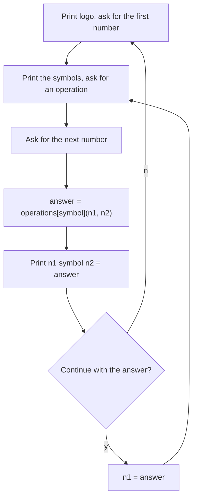

# Day 10 · Functions with Outputs

[← Day 9](../Day%209%20-%20Beginner%20-%20Dictionaries,%20Nesting%20and%20the%20Secret%20Auction/Day%209%20-%20Beginner%20-%20Dictionaries,%20Nesting%20and%20the%20Secret%20Auction.md) · [Roadmap](../../README.md#roadmap) <!-- nav -->

## TL;DR

- `return value` sends a result back. The call is replaced by that value, so it can be stored, printed, or passed on: `answer = add(2, 3)`.
- `print` only shows text in the console. `return` hands a value to the rest of the program, so outputs can be chained: `function_2(function_1("hello"))`.
- `return` ends the function at once. A bare `return`, or reaching the end without one, gives `None`.
- A **docstring** is a triple-quoted string on the first line of a function body. Editors show it when the function is used.
- Functions are values. Store one without parentheses (`operations = {"+": add}`) and call it later with them (`operations["+"](2, 3)`).

## Learning objectives

By the end of this day you should be able to:

- Write a function that returns a value, and use the result of the call.
- Explain the difference between printing a value and returning it.
- Use an early `return` to stop a function, and recognise `None`.
- Document a function with a docstring.
- Store functions in a variable or a dictionary and call them from there.
- Build a calculator that keeps working with its previous answer.

## Lessons

### 1. Day 10 Goals: what we will make by the end of the day

The project is a text calculator. It shows the full calculation, such as `5.0 / 2.0 = 2.5`, then offers to continue with the answer or start again. The [demo](https://appbrewery.github.io/python-day10-demo/) shows the flow.

### 2. Functions with Outputs

The course has now covered three kinds of functions: plain ones, ones with inputs, and ones with outputs. The keyword for an output is `return`:

```python
def format_name(f_name, l_name):
    formatted_f_name = f_name.title()
    formatted_l_name = l_name.title()
    return f"{formatted_f_name} {formatted_l_name}"

formatted = format_name("aNGeLa", "YU")   # the call becomes "Angela Yu"
print(formatted)
```

Think of a function as a machine: inputs go in, some processing happens, an output comes out. Built-ins work the same way. `len("Angela")` returns `6`, which is why `num_char = len("Angela")` works. `.title()` was found by searching for "Python title case", a normal way to discover a method.

Printing and returning are different. A function that only prints gives nothing back to the code that called it. A function that returns can feed its output into another function:

```python
def function_1(text):
    return text + text

def function_2(text):
    return text.title()

print(function_2(function_1("hello")))   # Hellohello
```

[Thonny](https://thonny.org/)'s debugger can step into each call to show where values go.

### 3. Multiple return values

A function can contain several `return` statements, but the first one reached ends it. Code after it never runs. An early `return` handles bad input before the main work starts:

```python
def format_name(f_name, l_name):
    if f_name == "" or l_name == "":
        return "You didn't provide valid inputs."
    return f"{f_name.title()} {l_name.title()}"
```

A bare `return`, with nothing after it, gives back `None`. Returning a message instead tells whoever called the function what went wrong.

### 4. Coding Exercise 10: Leap Year

[10_leap_year.py](exercises/10_leap_year.py) returns `True` or `False` for a year. A year divisible by 4 is a leap year, except when it is divisible by 100, unless it is also divisible by 400. So 2000 and 2400 are leap years, 2100 and 1989 are not. The checker wants the booleans, not the strings `"True"` and `"False"`.

### 5. Docstrings

A docstring documents a function. It is the first indented line after the `def` and uses triple quotes, so it can span several lines:

```python
def format_name(f_name, l_name):
    """Take a first and last name and return them in title case."""
```

Hovering over a call in an editor then shows this text, just as it shows "Return the number of items in a container." for `len()`. A loose triple-quoted string also works as a multi-line comment, but the usual advice is to select the lines and press **Ctrl+/** (**Cmd+/** on a Mac) to comment them with `#`.

The Udemy section includes a functions quiz here (multiple choice, no code file).

### 6. The Calculator Project

Functions can be stored like any other value. Leave off the parentheses to store the function instead of calling it:

```python
def add(n1, n2):
    return n1 + n2

my_favourite_operation = add       # no parentheses: store it
my_favourite_operation(2, 3)       # parentheses: call it, returns 5

operations = {"+": add, "-": subtract, "*": multiply, "/": divide}
operations["*"](4, 8)              # 32
```

The user's symbol becomes the dictionary key, so one line runs whichever operation they picked. Numbers are read with `float()`: without it, `"3" + "3"` is `"33"`. A `while` loop keeps going with the last answer as long as the user types `y`. On `n`, the course calls `calculator()` again from inside itself. A function calling itself is **recursion**. A second `while` loop around everything works just as well.

See [Project](#project).

### 7. How to Get a Good Night's Sleep

Sleep is when the brain consolidates what was learned, so rest is part of studying.

## Key concepts

| Concept | Summary |
| --- | --- |
| [Functions](../../concepts/functions.md) | `return`, `None`, docstrings, functions as values, and recursion |
| [Dictionaries](../../concepts/dictionaries.md) | A dictionary of functions keyed by operator symbol |
| [Strings](../../concepts/strings.md) | `.title()` returns a title-cased copy |
| [Type conversion](../../concepts/type-conversion.md) | `float(input(...))` so the numbers can be calculated |
| [Logical operators](../../concepts/logical-operators.md) | Combining the leap-year rules |

## Cheat sheet

```python
def multiply(n1, n2):
    """Return the product of n1 and n2."""
    return n1 * n2

result = multiply(4, 8)            # 32
print(multiply(2, multiply(3, 4))) # 24: one output feeds the next input

def check(n):
    if n < 0:
        return "negative"          # ends the function here
    return "ok"

def nothing():
    return                         # gives None

op = multiply                      # store the function
op(2, 5)                           # 10
```

## Common pitfalls

| Mistake | What Python says or does | Fix |
| --- | --- | --- |
| `print` instead of `return` inside the function | The caller gets `None`; `None + 1` raises `TypeError` | `return` the value, print it outside |
| Code after `return` | It never runs | Move it above the `return` |
| `operations = {"+": add()}` | `TypeError: add() missing 2 required positional arguments` | Store `add` without parentheses |
| `operations["+"]` without calling it | Prints something like `<function add at 0x...>` | Add the arguments: `operations["+"](n1, n2)` |
| Numbers left as strings | `"3" + "3"` gives `"33"` | Convert with `float()` or `int()` |
| Returning `"True"` from the leap-year check | The checker expects a boolean and fails | Return `True` or `False` without quotes |
| Dividing by zero | `ZeroDivisionError: division by zero` | Check the second number before dividing |

> [!TIP]
> If a value is unexpectedly `None`, look for a function that prints its result instead of returning it, or a path through the function that reaches the end without a `return`.

## Exercises

| # | Exercise | What it practises | Code |
| --- | --- | --- | --- |
| 10 | Leap Year | `return`, modulo, nested `if` or `and`/`or` | [10_leap_year.py](exercises/10_leap_year.py) |

<details>
<summary>Hint for exercise 10</summary>
Test 400 first: divisible by 400 returns True. Then divisible by 100 returns False. Then divisible by 4 returns True. Anything else returns False.
</details>

## Project

**Calculator**

- **Goal:** Pick two numbers and an operator, see the full calculation, and keep working with the answer.
- **How it works:**



- **Code:** [project/main.py](project/main.py). `add`, `subtract`, `multiply`, and `divide` return their results and sit in `operations` without parentheses. `y` keeps the answer as the next first number. `n` clears the screen and calls `calculator()` again. [project/art.py](project/art.py) holds `logo`.
- **Run:** `python project/main.py` from this day's folder.

### Ideas to extend it

- Refuse to divide by zero and ask for another number.
- Re-ask when the symbol is not one of the four keys.
- Add `**` for powers and `%` for remainders by adding two functions and two dictionary entries.

## Recall questions

<details>
<summary>What does <code>x = print("hi")</code> store in <code>x</code>?</summary>
None. print shows text but returns nothing.
</details>

<details>
<summary>What is the difference between printing a value inside a function and returning it?</summary>
Printing only shows it in the console. Returning hands it back to the caller, which can store it, print it, or pass it to another function.
</details>

<details>
<summary>A function has a <code>print</code> after its <code>return</code>. When does that print run?</summary>
Never. return ends the function, so the lines after it are skipped.
</details>

<details>
<summary>Why is <code>{"+": add}</code> written without parentheses after <code>add</code>?</summary>
Parentheses call the function. Without them the dictionary stores the function itself, to be called later.
</details>

<details>
<summary>Is 1900 a leap year?</summary>
No. It divides by 4 and by 100, but not by 400.
</details>

<details>
<summary>Where does a docstring go, and what is it for?</summary>
On the first line of the function body, in triple quotes. It documents what the function does, and editors show it when the function is called.
</details>

## Further reading

- [Defining functions](https://docs.python.org/3/tutorial/controlflow.html#defining-functions) in the Python tutorial, including `return`
- [PEP 257: Docstring conventions](https://peps.python.org/pep-0257/)
- [str.title](https://docs.python.org/3/library/stdtypes.html#str.title)
- [Thonny](https://thonny.org/), a beginner IDE with a step-by-step debugger

---

[← Day 9](../Day%209%20-%20Beginner%20-%20Dictionaries,%20Nesting%20and%20the%20Secret%20Auction/Day%209%20-%20Beginner%20-%20Dictionaries,%20Nesting%20and%20the%20Secret%20Auction.md) · [Roadmap](../../README.md#roadmap) <!-- nav -->
