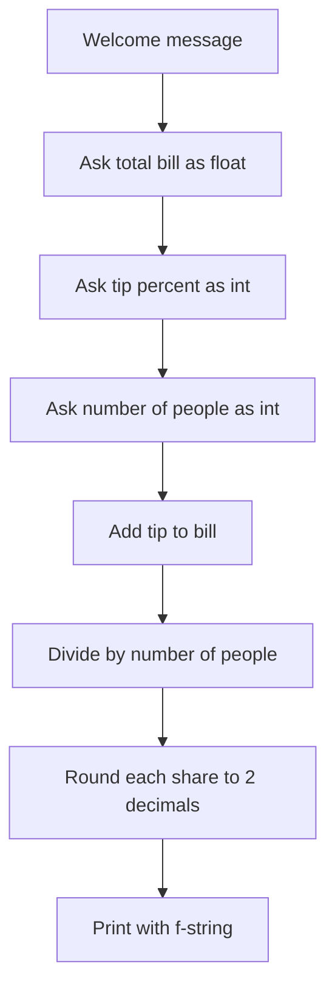

# Day 2 · Understanding Data Types and How to Manipulate Strings

[← Day 1](../Day%201%20-%20Beginner%20-%20Working%20with%20Variables%20in%20Python%20to%20Manage%20Data/Day%201%20-%20Beginner%20-%20Working%20with%20Variables%20in%20Python%20to%20Manage%20Data.md) · [Roadmap](../../README.md#roadmap) <!-- nav -->

## TL;DR

- Python's four **primitive data types** are **strings** (`str`), **integers** (`int`), **floats** (`float`) and **booleans** (`bool`). The type decides what `+` and other operators do.
- **Subscripting** with `[index]` pulls one character from a string; the first character is index `0`, and `-1` is the last.
- **`type()`** checks a value's type; **`int()`**, **`float()`** and **`str()`** convert between types. `input()` always returns a **string**, so convert before doing maths.
- **`TypeError`** means the operation does not fit the types; **`ValueError`** means the value cannot be converted (for example `int("abc")`).
- Maths uses `+ - * /`, `//` (floor division), and `**` (powers). **`/` always gives a float** in Python 3. Use **PEMDAS** (and work left to right for `*` and `/`).
- **`round()`**, compound assignment (`+=`, …) and **f-strings** (`f"Hello {name}"`) format numbers in output without chaining `str()` and `+`.

## Learning objectives

By the end of this day you should be able to:

- Name the four primitive data types and tell a string from a number in code.
- Use subscripting and negative indices on strings.
- Check types with `type()` and convert values with `int()`, `float()` and `str()`.
- Explain and fix common `TypeError` and `ValueError` messages.
- Perform arithmetic with correct operator precedence (PEMDAS).
- Round numbers and use f-strings to mix text and numbers in one `print()`.
- Read numeric answers from `input()` by converting them to `float` or `int`.
- Build a Tip Calculator that splits a bill including a percentage tip.

## Lessons

### 13. Day 2 Goals: what we will make by the end of the day

Day 2 deepens how Python stores and calculates data. The lessons cover data types, arithmetic, type conversion and f-strings. The day ends with a **Tip Calculator** that asks for the bill, a tip percentage and the number of people, then prints each person's share rounded to two decimal places.

### 14. Python Primitive Data Types

`len()` counts characters in a string, but `len(123)` fails with a **TypeError** because an integer is not a sequence of characters. That mistake is the entry point into **data types**: each value has a type, and functions only accept types they understand.

The four **primitive** types used throughout the course are:

| Type | Role | Example |
| --- | --- | --- |
| `str` | Text in quotes | `"hello"` |
| `int` | Whole numbers | `42`, `1_000_000` |
| `float` | Numbers with a decimal point | `3.14159` |
| `bool` | True or false | `True`, `False` |

**Subscripting** selects one character from a string with square brackets:

```python
print("hello"[0])   # h — first character, index 0
print("hello"[4])   # o — fifth character
print("hello"[-1])  # o — last character
```

Programmers count from **zero**. If the result is "one too many" or "one too few", check whether counting started at 0 or 1.

Digits in quotes are strings, not numbers:

```python
print("123" + "345")  # 123345 — concatenation
print(123 + 345)        # 468 — addition
```

Integers can use underscores for readability: `1_000_000` is the same as `1000000`. Underscores are for humans; Python ignores them.

`True` and `False` are booleans. They are capitalised and have no quotation marks. Boolean logic drives decisions, covered on Day 3.

A short **quiz** after this lecture checks whether you can spot valid types and names.

### 15. Type Error, Type Checking and Type Conversion

Each function expects certain types. `len()` accepts sized sequences such as strings, not bare integers. PyCharm's documentation popup and [docs.python.org](https://docs.python.org/3/library/functions.html#len) list what each function allows.

**Type checking** uses `type()`:

```python
print(type("hello"))  # <class 'str'>
print(type(3))          # <class 'int'>
print(type(3.14))       # <class 'float'>
print(type(True))       # <class 'bool'>
```

**Type conversion** (type casting) builds a new value of another type:

```python
int("123")    # 123
float("3.14")
str(42)       # "42"
int("123") + int("456")  # 579
```

If the string is not a valid number, conversion fails:

```python
int("abc")  # ValueError: invalid literal for int() with base 10: 'abc'
```

Combining types incorrectly raises **TypeError**:

```python
print("Number of letters: " + len("Ada"))  # TypeError: can only concatenate str (not "int") to str
```

Fix it by converting the integer to a string, or by using an f-string (covered later today):

```python
length = len("Ada")
print("Number of letters: " + str(length))
```

Pause challenges in the lecture practise `type()` on all four primitives and fixing the "number of letters in your name" program.

### 16. Mathematical Operations in Python

On numbers, `+` and `-` add and subtract, `*` multiplies, and `/` divides.

```python
print(3 * 2)   # 6
print(6 / 3)   # 2.0 — true division, always a float
print(6 // 3)  # 2 — floor division, integer result
print(2 ** 3)  # 8 — exponent (2³)
```

`5 // 3` is `1`, not `2`: floor division drops the decimal part instead of rounding.

**PEMDAS** sets the order of operations: **P**arentheses, **E**xponents, **M**ultiplication and **D**ivision (equal priority, **left to right**), **A**ddition and **S**ubtraction (equal priority, left to right). A common mnemonic adds **LR** for that left-to-right rule among equals.

```python
print(3 * 3 + 3 / 3 - 3)  # 7.0
print(3 * (3 + 3) / 3 - 3)  # 3.0 — parentheses first
```

Thonny's debugger can step through such a line and show each intermediate result.

The next item in the course is **Coding Exercise 4: BMI Calculator**, which uses division and `**` on height and weight.

### 17. Number Manipulation and F Strings in Python

The BMI exercise prints a long decimal. **`int()`** chops off decimal places (floors toward zero). **`round()`** rounds to the nearest whole number:

```python
bmi = 30.85
print(int(bmi))    # 30
print(round(bmi))  # 31
print(round(bmi, 2))  # 30.85 — two decimal places
```

**Assignment operators** update a variable from its old value:

```python
score = 0
score += 1   # same idea as score = score + 1
score -= 1
score *= 2
score /= 2
```

To print text with numbers, chaining `+` and `str()` works but is awkward:

```python
score = 10
print("Your score is " + str(score))
```

An **f-string** puts an `f` before the opening quote and variables inside `{curly braces}`:

```python
score = 10
height = 1.8
is_winning = True
print(f"Score: {score}, height: {height}, winning: {is_winning}")
```

Python converts the values to text inside the braces, so the types can differ.

### 18. Day 2 Project: Tip Calculator

The project combines inputs, type conversion, percentages, division and rounding. See [Project](#project).

### 19. You are already in the top 50%

A short encouragement clip: finishing two days in a row already puts you ahead of many people who start learning and stop. Rest before Day 3, which introduces **conditional statements** (`if` / `else`).

## Key concepts

| Concept | Summary |
| --- | --- |
| [Data types](../../concepts/data-types.md) | `str`, `int`, `float`, `bool` and how arithmetic treats them |
| [Strings](../../concepts/strings.md) | Subscripting, indexing from zero, negative indices |
| [Type conversion](../../concepts/type-conversion.md) | `type()`, `int()`, `float()`, `str()` and when to use each |
| [F-strings](../../concepts/f-strings.md) | `f"..."` with `{variables}` for readable output |
| [Input and output](../../concepts/input-and-output.md) | Converting `input()` answers before maths |
| [Errors and debugging](../../concepts/errors-and-debugging.md) | `TypeError` and `ValueError` on Day 2 |

## Cheat sheet

```python
# Types
type("hi")       # <class 'str'>
type(3)          # <class 'int'>
type(3.0)        # <class 'float'>
type(True)       # <class 'bool'>

# Subscripting (indices start at 0)
"Python"[0]      # P
"Python"[-1]    # n

# Conversion
int("42")
float("3.14")
str(100)

# Arithmetic
10 + 3
10 - 3
10 * 3
10 / 3      # 3.333...
10 // 3     # 3
2 ** 4      # 16

# Precedence — parentheses win
print(2 + 3 * 4)       # 14
print((2 + 3) * 4)     # 20

# Round and assignment
round(3.7)             # 4
round(3.14159, 2)      # 3.14
score = 0
score += 1

# Numeric input
bill = float(input("Bill? "))
people = int(input("People? "))

# f-string
print(f"Each pays: {round(bill / people, 2)}")
```

## Common pitfalls

| Mistake | What Python says | Fix |
| --- | --- | --- |
| `len(123)` | `TypeError: object of type 'int' has no len()` | Pass a string (or other sequence), not an integer |
| `"Total: " + 42` | `TypeError: can only concatenate str (not "int") to str` | Use `str(42)` or an f-string |
| `int("3.14")` | `ValueError: invalid literal for int()...` | Use `float()` first, or `int(float("3.14"))` if appropriate |
| `int("abc")` | `ValueError: invalid literal for int() with base 10: 'abc'` | Only convert strings that are valid numbers |
| `bill = input(...); bill * 1.12` | `TypeError` on multiply with `str` | `bill = float(input(...))` |
| `6 / 3 == 2` | Condition is false (`2.0` vs `2`) | Remember `/` returns a float; use `//` for integer division |
| `5 // 3` expected to be `2` | Result is `1` | Floor division drops decimals; use `/` if you need the true quotient |
| Using `int()` expecting round | Value truncates: `int(3.9)` → `3` | Use `round()` for nearest whole number |
| Forgetting `f` prefix | `{x}` printed literally | Write `f"..."` not just `"..."` |

> [!TIP]
> When a number from `input()` should be used in maths, convert on the same line or the line immediately after: `total = float(input("Bill? "))`.

## Exercises

| # | Exercise | What it practises | Code |
| --- | --- | --- | --- |
| 4 | BMI Calculator | `float`/`int` conversion, `**`, division, printing a whole-number BMI | [04_bmi_calculator.py](exercises/04_bmi_calculator.py) |

The course also includes **Quiz 2: Data Types** and **Quiz 3: Mathematical Operations** on Udemy (multiple choice, no code file). In-video pause challenges cover `type()`, fixing `len()` with a string, and the "letters in your name" program.

<details>
<summary>Hint for exercise 4</summary>
Convert height and weight to numbers before the formula. BMI is weight divided by height squared: weight / (height ** 2). The course asks for a whole number in the output, so use int() on the result (or round then int, depending on what matches the expected output).
</details>

## Project

**Tip Calculator**

- **Goal:** Ask for the bill, tip percentage and number of people; print how much each person pays, rounded to two decimal places.
- **How it works:**



- **Tip maths:** A tip of 12% on a bill is `bill * 12 / 100`, or in one step `bill * 1.12` (multiply by one plus the percentage as a decimal).
- **Example run** (bill $124.56, tip 12%, 7 people):

```text
Welcome to the tip calculator!
What was the total bill? $124.56
What percentage tip would you like to give? 10, 12, or 15? 12
How many people to split the bill? 7
Each person should pay: $19.93
```

- **Code:** [project/main.py](project/main.py). The calculation is:

```python
each_person = round(bill * (1 + tip / 100) / people, 2)
print(f"Each person should pay: ${each_person}")
```

- **Run:** `python project/main.py` from this day's folder.

> [!NOTE]
> Floats can show tiny rounding noise (`168.00000000000003`). That is normal in Python; `round(..., 2)` is for display. The course links optional reading on [floating-point arithmetic](https://docs.python.org/3/tutorial/floatingpoint.html) under the project's resources.

### Ideas to extend it

- Ask for the currency symbol and print it with each amount.
- Offer fixed tip options (10, 15, 20) and validate the input.
- Print the total bill including tip before splitting.
- Day 3+: add a message if the tip is unusually low or high using `if` / `else`.

## Recall questions

<details>
<summary>What does <code>print(type(3.14))</code> show?</summary>
&lt;class 'float'&gt; — 3.14 is a floating-point number.
</details>

<details>
<summary>What does <code>print("Python"[0])</code> print?</summary>
P — index 0 is the first character.
</details>

<details>
<summary>What is <code>print("5" + "3")</code> vs <code>print(5 + 3)</code>?</summary>
53 is string concatenation; 8 is integer addition.
</details>

<details>
<summary>Why does <code>6 / 3</code> print <code>2.0</code> and not <code>2</code>?</summary>
In Python 3, / always returns a float, even when the division is exact.
</details>

<details>
<summary>What is <code>5 // 3</code>?</summary>
1 — floor division keeps the integer part and drops the remainder.
</details>

<details>
<summary>What is <code>2 ** 10</code>?</summary>
1024 — ** raises the left number to the power of the right.
</details>

<details>
<summary>What does <code>3 * 3 + 3 / 3 - 3</code> evaluate to?</summary>
7.0 — multiply and divide before add and subtract; multiply and divide go left to right.
</details>

<details>
<summary>What error does <code>int("hello")</code> raise?</summary>
ValueError — the string is not a valid integer literal.
</details>

<details>
<summary>What is the difference between <code>int(3.9)</code> and <code>round(3.9)</code>?</summary>
int(3.9) is 3 (truncates); round(3.9) is 4 (nearest whole number).
</details>

<details>
<summary>What does <code>score = 0; score += 1; print(score)</code> print?</summary>
1 — += adds 1 to the current value of score.
</details>

<details>
<summary>With <code>name = "Ada"</code>, what does <code>print(f"Hi {name}")</code> print?</summary>
Hi Ada — the f-string replaces {name} with the variable's value.
</details>

## Further reading

- [Built-in types](https://docs.python.org/3/library/stdtypes.html) in the Python documentation
- [int()](https://docs.python.org/3/library/functions.html#int), [float()](https://docs.python.org/3/library/functions.html#float), [round()](https://docs.python.org/3/library/functions.html#round)
- [Floating-point arithmetic](https://docs.python.org/3/tutorial/floatingpoint.html) (why `1.12 * 150` may show extra digits)
- [Formatted string literals (f-strings)](https://docs.python.org/3/reference/lexical_analysis.html#formatted-string-literals)
- [Thonny](https://thonny.org) debugger for stepping through PEMDAS examples

---

[← Day 1](../Day%201%20-%20Beginner%20-%20Working%20with%20Variables%20in%20Python%20to%20Manage%20Data/Day%201%20-%20Beginner%20-%20Working%20with%20Variables%20in%20Python%20to%20Manage%20Data.md) · [Roadmap](../../README.md#roadmap) <!-- nav -->
