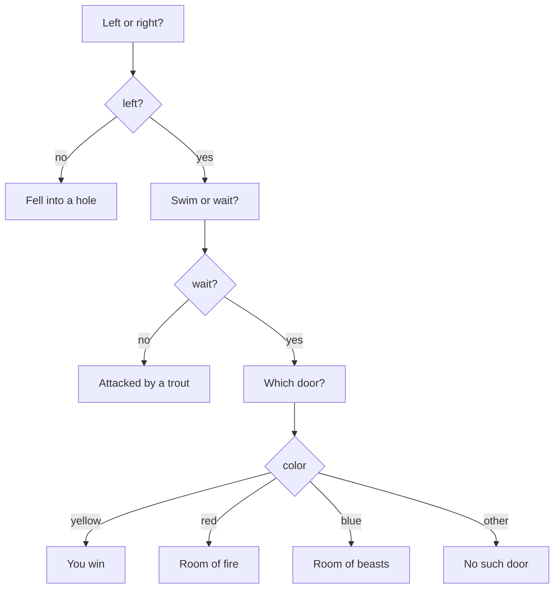

# Day 3 · Control Flow and Logical Operators

[← Day 2](../Day%202%20-%20Beginner%20-%20Understanding%20Data%20Types%20and%20How%20to%20Manipulate%20Strings/Day%202%20-%20Beginner%20-%20Understanding%20Data%20Types%20and%20How%20to%20Manipulate%20Strings.md) · [Roadmap](../../README.md#roadmap) · [Day 4 →](../Day%204%20-%20Beginner%20-%20Randomisation%20and%20Python%20Lists/Day%204%20-%20Beginner%20-%20Randomisation%20and%20Python%20Lists.md) <!-- nav -->

## TL;DR

- An **`if`** runs its indented block only when the condition is true. **`else`** runs when it is false. **`elif`** tries another condition only after earlier ones failed.
- Comparisons use `==`, `!=`, `<`, `>`, `<=`, `>=`. A single `=` assigns; it does not compare.
- **`%`** (modulo) is the remainder. `number % 2 == 0` means the number is even.
- A second **`if`** after an `if`/`elif`/`else` is a new test, so it can still run. Another **`elif`** cannot, because those branches are mutually exclusive.
- **`and`**, **`or`**, and **`not`** combine or invert conditions. `.lower()` makes an `input()` answer easier to compare.

## Learning objectives

By the end of this day you should be able to:

- Write an `if`/`else` that chooses between two outcomes.
- Compare numbers and strings with the six comparison operators.
- Use `%` to test divisibility, including even and odd numbers.
- Nest `if` statements and replace a ladder of nested checks with `elif`.
- Use separate `if` statements when more than one block should be able to run.
- Combine conditions with `and`, `or`, and `not`.
- Normalise typed answers with `.lower()` before comparing them.
- Build a short choose-your-own-adventure with nested branches.

## Lessons

### Day 3 Goals: what we will make by the end of the day

Day 3 is about decisions. A program stops being a straight list of lines and starts choosing what to run. The day's project is **Treasure Island**, a choose-your-own-adventure: each answer picks the next branch, and only one path wins.

The running example in the lessons is a roller-coaster ticket booth. Height, age, a photo, and a discount are added one idea at a time.

### Control Flow with if / else and Conditional Operators

**Control flow** is the order in which lines run. Without a condition, Python runs from top to bottom. An `if` skips its block when the condition is false.

```python
height = int(input("Height in cm: "))
if height >= 120:
    print("You can ride.")
else:
    print("Sorry, you need to be taller.")
```

The lines indented under `if` or `else` are that branch's **code block**. Python uses indentation, usually four spaces, instead of braces. A block that is not indented raises `IndentationError`.

An `if` does not hide names. A variable created inside the block still exists afterwards. Functions, which do create their own scope, come later in the course.

**Comparison operators** produce `True` or `False`:

| Operator | True when |
| --- | --- |
| `==` | the two values are equal |
| `!=` | the two values are not equal |
| `>` | the left value is greater |
| `<` | the left value is smaller |
| `>=` | greater or equal |
| `<=` | smaller or equal |

```python
print(5 > 3)    # True
print(5 == 5)   # True
print(5 = 5)    # SyntaxError — one = assigns, it does not compare
```

Strings compare too, and the match is case-sensitive: `"Left" == "left"` is false. Call `.lower()` on the answer before comparing it.

### Introducing the Modulo

**`%`** divides and keeps the remainder.

```python
print(7 % 2)   # 1
print(10 % 2)  # 0
print(13 % 5)  # 3
```

A remainder of `0` means the left number divides exactly by the right number. The lesson's in-video check uses that test for even and odd. The prompt can be anything; one version is "What is the number you want to check?". Store the answer as an `int`, then branch:

```python
number_to_check = int(input("What is the number you want to check? "))
if number_to_check % 2 == 0:
    print("This is an even number.")
else:
    print("This is an odd number.")
```

That check lives inside the modulo lesson. It is not a separate numbered coding exercise. `45` is odd and `34` is even.

### Nested if statements and elif statements

A check can sit inside another check. After the height test passes, the booth asks for an age and picks a price:

- under 12: $5
- 12 to 18: $7
- over 18: $12

Written as nested `if`/`else`, the age tests live inside the "tall enough" block. The same ladder is easier to read with **`elif`**: each branch is tried only if every condition above it was false, and at most one branch runs.

```python
if age < 12:
    bill = 5
elif age <= 18:
    bill = 7
else:
    bill = 12
print(f"Your ticket is ${bill}.")
```

Order matters. `elif age <= 18` is only reached when `age < 12` was already false, so it means "12 to 18" without writing that lower bound again.

[Exercise 5](exercises/05_bmi_calculator.py) uses the same shape on a BMI that is already calculated. Do not change the given `weight` and `height`. Print one label: `underweight` below 18.5, `normal weight` from 18.5 up to but not including 25, and `overweight` from 25 upward. The given numbers land in `normal weight`.

### Multiple If Statements in Succession

`if`/`elif`/`else` picks **one** path. A later question that should apply on top of that choice needs its **own** `if`.

The booth then asks whether the rider wants a photo for $3. That is not another age band, so it is not an `elif`. A new `if` runs even after the age block has already chosen a price:

```python
if wants_photo == "y":
    bill += 3
print(f"Your ticket is ${bill}.")
```

`elif wants_photo == "y"` would be wrong here: it would be skipped whenever an earlier age condition had already succeeded.

### Pizza Order Practice

The next lesson is a bill, not another ticket price. [pizza_order.py](exercises/pizza_order.py) already asks for `size`, `pepperoni`, and `extra_cheese`. Size picks the base price with `if`/`elif`/`else`: small 15, medium 20, large 25. Pepperoni is a nested check after the customer said yes: +2 on a small, +3 otherwise. Extra cheese is a separate `if` that adds 1. A large pizza with pepperoni and no cheese is $28. The printed line is `Your final bill is: $28.` including the full stop.

### Logical Operators

One comparison is not always enough. **Logical operators** join tests:

| Operator | True when |
| --- | --- |
| `and` | both sides are true |
| `or` | at least one side is true |
| `not` | the single condition is false |

```python
print(True and False)   # False
print(True or False)    # True
print(not True)         # False
```

The booth's last rule is a free ride for ages 45 to 55. Both bounds have to hold:

```python
if age >= 45 and age <= 55:
    bill = 0
```

`or` would be the wrong operator: `age >= 45 or age <= 55` is true for almost every age. `not` inverts one test, for example `if not is_tall:`.

Python also chains comparisons: `45 <= age <= 55` means the same as `age >= 45 and age <= 55`. Either form is fine; the lesson's form is `and`.

### Day 3 Project: Treasure Island

Three questions, nested. Only left, then wait, then the yellow door wins. See [Project](#project). `.lower()` belongs on every answer so `"Left"` and `"left"` take the same branch.

## Key concepts

| Concept | Summary |
| --- | --- |
| [Conditionals](../../concepts/conditionals.md) | `if`, `elif`, `else`, indentation, and comparison operators |
| [Modulo](../../concepts/modulo.md) | `%` for the remainder, and testing divisibility |
| [Logical operators](../../concepts/logical-operators.md) | `and`, `or`, and `not` |
| [Strings](../../concepts/strings.md) | `.lower()` so comparisons ignore capital letters |
| [Input and output](../../concepts/input-and-output.md) | Reading a choice, then printing the branch that matched |
| [Errors and debugging](../../concepts/errors-and-debugging.md) | `IndentationError` when a block is not indented |

## Cheat sheet

```python
# Comparisons — one = assigns, two compare
height = 130
height >= 120     # True
height == 120     # False
height != 120     # True

# if / elif / else — only one branch runs
if height >= 120:
    print("You can ride.")
elif height >= 100:
    print("You can ride with an adult.")
else:
    print("Too short.")

# A later if is a new test, so it can also run
wants_photo = "y"
if wants_photo == "y":
    print("Photo added.")

# Remainder
7 % 2             # 1
10 % 2 == 0       # True — even

# Combine conditions
age = 50
if age >= 45 and age <= 55:
    print("Free ticket.")

# Answers are case-sensitive until you normalise them
choice = input("Left or right? ")
if choice.lower() == "left":
    print("You go left.")
```

## Common pitfalls

| Mistake | What Python says or does | Fix |
| --- | --- | --- |
| `if height = 120:` | `SyntaxError: invalid syntax` | Compare with `==`. Use `=` only to store a value |
| Body of `if` starts at column 0 | `IndentationError: expected an indented block` | Indent the block, normally by four spaces |
| `"Left" == "left"` | The condition is false, so the branch is skipped | Compare `choice.lower()` |
| Photo added with `elif` | The photo line never runs after a true age test | Use a new `if` when both blocks should be able to run |
| `age >= 45 or age <= 55` | Almost every age matches | Use `and` when both bounds must hold |
| `number % 2 = 0` | `SyntaxError` | The test is `number % 2 == 0` |
| Forgetting `int()` or `float()` on `input()` | `TypeError` when comparing the answer to a number | Convert first: `age = int(input("Age: "))` |

> [!TIP]
> When a branch seems to be skipped, print the exact value you are comparing, including its type. `"18"` and `18` are not equal.

## Exercises

| # | Exercise | What it practises | Code |
| --- | --- | --- | --- |
| 5 | BMI Calculator with Interpretations | `if`/`elif`/`else` on a BMI that is already calculated | [05_bmi_calculator.py](exercises/05_bmi_calculator.py) |

Odd or even is the in-video check in the modulo lesson, not its own coding exercise. Pizza Order is the practice inside lecture 26: [pizza_order.py](exercises/pizza_order.py). The course also includes a **logical operators quiz** on Udemy (multiple choice, no code file).

<details>
<summary>Hint for exercise 5</summary>
Leave weight, height, and bmi as they are. Test the smallest band first: bmi &lt; 18.5 prints underweight. The next elif is bmi &lt; 25, which prints normal weight. else prints overweight. Print only the category, not the number.
</details>

<details>
<summary>Hint for the pizza practice</summary>
Start bill at 0. Size uses if/elif/else and += 15, 20, or 25. After a yes to pepperoni, a nested if adds 2 for S and 3 otherwise. Cheese is a new if, not an elif, and adds 1. Print Your final bill is: $ and the amount, then a full stop.
</details>

## Project

**Treasure Island**

- **Goal:** Ask three questions. Only one sequence of answers finds the treasure. Every other answer ends the game.
- **How it works:**



- **Branches:** anything other than left ends in a hole; anything other than wait ends with a trout; red is fire; blue is beasts; yellow wins; any other door does not exist. The third prompt asks `Which colour do you choose?`. Compare `.lower()` answers so capital letters still match.
- **Code:** [project/main.py](project/main.py). The winning path is left, then wait, then yellow:

```python
choice1 = input('You\'re at a cross road. Where do you want to go? Type "left" or "right" \n').lower()
if choice1 == "left":
    choice2 = input('You\'ve come to a lake. There is an island in the middle of the lake. Type "wait" to wait for a boat. Type "swim" to swim across. \n').lower()
    if choice2 == "wait":
        choice3 = input("You arrive at the island unharmed. There is a house with 3 doors. One red, one yellow and one blue. Which colour do you choose? \n").lower()
        if choice3 == "yellow":
            print("You found the treasure! You Win!")
```

- **Run:** `python project/main.py` from this day's folder.

> [!NOTE]
> `main.py` prints the treasure-chest banner before the first question. The pictures do not change which path wins.

### Ideas to extend it

- Add a fourth question on the winning path.
- Reject an empty answer and ask again. Repeating a question fits a loop, which is Day 5; for now a nested `if` is enough.
- Count how many choices the player got right and print that at the end.

## Recall questions

<details>
<summary>What does <code>print(7 % 2)</code> print?</summary>
1 — 7 divided by 2 is 3 with remainder 1.
</details>

<details>
<summary>What is wrong with <code>if score = 10:</code>?</summary>
A single = assigns. A comparison uses ==, so the line should be if score == 10:.
</details>

<details>
<summary>With <code>height = 100</code>, what does <code>if height &gt;= 120: print("yes")</code> followed by <code>else: print("no")</code> print?</summary>
no — 100 is not greater than or equal to 120, so the else branch runs.
</details>

<details>
<summary>Why can a second <code>if</code> run after an <code>if</code>/<code>elif</code>/<code>else</code>, when another <code>elif</code> cannot?</summary>
elif belongs to the same chain and is skipped once an earlier condition was true. A new if starts a separate test.
</details>

<details>
<summary>What do <code>True and False</code>, <code>True or False</code>, and <code>not True</code> each evaluate to?</summary>
False, True, and False.
</details>

<details>
<summary>What does <code>"Left".lower()</code> return?</summary>
left — lower() returns a new string with every letter in lowercase.
</details>

<details>
<summary>A BMI of 24.8 should print which of underweight, normal weight, or overweight?</summary>
normal weight — 24.8 is from 18.5 up to, but not including, 25.
</details>

<details>
<summary>Small pizza $15, pepperoni +$2, extra cheese +$1. What is the bill for a small pizza with both extras?</summary>
18.
</details>

## Further reading

- [if statements](https://docs.python.org/3/tutorial/controlflow.html#if-statements) in the Python tutorial
- [Comparisons](https://docs.python.org/3/reference/expressions.html#comparisons) and [boolean operations](https://docs.python.org/3/reference/expressions.html#boolean-operations)
- [Truth value testing](https://docs.python.org/3/library/stdtypes.html#truth-value-testing)
- [str.lower()](https://docs.python.org/3/library/stdtypes.html#str.lower)

---

[← Day 2](../Day%202%20-%20Beginner%20-%20Understanding%20Data%20Types%20and%20How%20to%20Manipulate%20Strings/Day%202%20-%20Beginner%20-%20Understanding%20Data%20Types%20and%20How%20to%20Manipulate%20Strings.md) · [Roadmap](../../README.md#roadmap) · [Day 4 →](../Day%204%20-%20Beginner%20-%20Randomisation%20and%20Python%20Lists/Day%204%20-%20Beginner%20-%20Randomisation%20and%20Python%20Lists.md) <!-- nav -->
