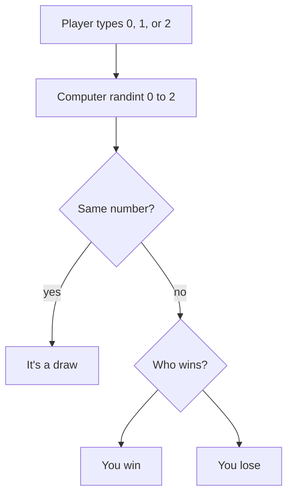

# Day 4 · Randomisation and Python Lists

[← Day 3](../Day%203%20-%20Beginner%20-%20Control%20Flow%20and%20Logical%20Operators/Day%203%20-%20Beginner%20-%20Control%20Flow%20and%20Logical%20Operators.md) · [Roadmap](../../README.md#roadmap) · [Day 5 →](../Day%205%20-%20Beginner%20-%20Python%20Loops/Day%205%20-%20Beginner%20-%20Python%20Loops.md) <!-- nav -->

## TL;DR

- Computers are deterministic. `import random` uses a pseudorandom generator so a program can vary each run.
- `random.randint(a, b)` includes both ends. `random.random()` is a float from 0 inclusive up to, but not including, 1.
- A **list** keeps items in order inside `[]`. The first item is index `0`. Index `-1` is the last item.
- `append()` adds one item at the end. `extend()` adds every item from another list. A list can contain other lists.
- `IndexError: list index out of range` usually means the index is one past the end. The last index is `len(items) - 1`.

## Learning objectives

By the end of this day you should be able to:

- Import a module and call a function that belongs to it.
- Generate a random integer or float in a chosen range.
- Build a list, read an item by index, and add items with `append()` or `extend()`.
- Pick a random item with `random.choice()` or with `randint` plus an index.
- Read an `IndexError` and fix an off-by-one index.
- Put one list inside another and read an inner item.
- Build Rock Paper Scissors with a random computer choice.

## Lessons

### Day 4 Goals: what we will make by the end of the day

The project is Rock Paper Scissors. The player types `0` for rock, `1` for paper, or `2` for scissors. The program shows both shapes and says who won. The same choice is a draw. Rock beats scissors, scissors beats paper, and paper beats rock.

### Random Module

A normal program does the same thing every time. Games need a result that is not fixed in advance. Python does not roll a physical die. The `random` module uses a pseudorandom number generator (the Mersenne Twister). The numbers look random and are good enough for games. They are not a source of secret keys.

```python
import random

random_integer = random.randint(1, 10)   # 1 and 10 are both possible
random_float = random.random()            # 0.0 up to, but not including, 1.0
wider = random.random() * 10              # 0.0 up to, but not including, 10.0
```

`random.uniform(a, b)` also returns a float and is documented as including both ends. Rounding can make the top end unreliable, so the lesson prefers `random.random()` multiplied to the width you want.

A **module** is a separate Python file of related code. `import random` loads that file. `random.randint` means "the `randint` function inside the `random` module". The same pattern works for a file you write yourself: `import my_module`, then `my_module.my_favorite_number`.

The in-video check is a coin toss. `randint(0, 1)` is heads when the result is `0` and tails otherwise:

```python
import random

toss = random.randint(0, 1)
if toss == 0:
    print("Heads")
else:
    print("Tails")
```

### Understanding the Offset and Appending Items to Lists

Separate variables (`state1`, `state2`, ...) fall apart as soon as the collection grows. A list holds the whole collection under one name:

```python
fruits = ["Cherry", "Apple", "Pear"]
print(fruits[0])    # Cherry
print(fruits[-1])   # Pear
```

The number in the brackets is the **offset** from the start. Offset `0` is the first item. Offset `2` is two steps in. A negative offset counts back from the end.

`append(item)` adds that one item after the current last item. `extend(other_list)` adds each item from `other_list`, not the list as a single object. The [list methods](https://docs.python.org/3/tutorial/datastructures.html#more-on-lists) page has the rest. There is no need to memorise them.

### Who will pay the bill?

[who_pays.py](exercises/who_pays.py) holds a list of five names. Alice is index `0`, so a random index is `randint(0, 4)`. Two solutions are both valid:

```python
print(random.choice(friends))
print(friends[random.randint(0, len(friends) - 1)])
```

`random.choice` is the shorter one. The index version only uses `randint` and square brackets. `len(friends) - 1` stays correct if the list later changes length. A hard-coded `4` does not.

### IndexErrors and Working with Nested Lists

`len(states_of_america)` is 50, so the last state is index `49`. Index `50` does not exist. Python stops with `IndexError: list index out of range`. Using `len` itself as the index is the usual off-by-one: the length counts the items, and the last offset is one less.

Related items can stay in two lists and those lists can sit inside a third:

```python
fruits = ["Strawberries", "Apples"]
vegetables = ["Spinach", "Kale"]
dirty_dozen = [fruits, vegetables]
print(dirty_dozen[0][1])   # Apples
```

The first index picks the inner list. The second index picks the item inside it.

### Day 4 Project: Rock Paper Scissors

See [Project](#project). The player and the computer each end up as `0`, `1`, or `2`. `input()` returns a string, so compare only after `int()`. A larger number does not always win: scissors is `2` and rock is `0`, and rock still wins.

## Key concepts

| Concept | Summary |
| --- | --- |
| [Random](../../concepts/random.md) | `import random`, `randint`, `random`, `choice` |
| [Lists](../../concepts/lists.md) | Order, indexes, `append`, `extend`, nesting |
| [Errors and debugging](../../concepts/errors-and-debugging.md) | `IndexError` and the off-by-one index |
| [Conditionals](../../concepts/conditionals.md) | Heads/tails, and who wins at Rock Paper Scissors |
| [Input and output](../../concepts/input-and-output.md) | `int(input(...))` so a typed choice is a number |

## Cheat sheet

```python
import random

random.randint(0, 2)          # 0, 1, or 2
random.random()               # float, 0.0 inclusive, 1.0 exclusive
random.choice(["a", "b"])     # one of the items

items = ["a", "b", "c"]
items[0]                      # "a"
items[-1]                     # "c"
items.append("d")             # ["a", "b", "c", "d"]
items.extend(["e", "f"])      # adds e and f, not a nested list
len(items) - 1                # last valid index

nested = [["x", "y"], ["z"]]
nested[1][0]                  # "z"
```

## Common pitfalls

| Mistake | What Python says or does | Fix |
| --- | --- | --- |
| `randint(1, 10)` and expecting 10 to be impossible | 10 can appear | `randint` includes both ends. `random()` does not include 1 |
| `random.randint` with no import | `NameError: name 'random' is not defined` | `import random` first |
| `items[len(items)]` | `IndexError: list index out of range` | Last index is `len(items) - 1` |
| `append([1, 2])` when you wanted two items | The list gains one item, which is itself a list | Use `extend([1, 2])` to add 1 and 2 |
| `if computer > user` for Rock Paper Scissors | Scissors (`2`) beats a false "computer wins" against rock (`0`) | Handle the wrap-around, or compare the three shapes directly |
| `input()` compared with `>` to an int | `TypeError: '>' not supported between instances of 'str' and 'int'` | `choice = int(input(...))` |

> [!TIP]
> Print the index and `len(items)` when a list lookup fails. The traceback's index is often exactly one past the end.

## Exercises

Day 4 has no numbered coding exercise. Two checks live inside the lessons:

| Check | What it practises | Code |
| --- | --- | --- |
| Heads or tails | `randint(0, 1)` and `if`/`else` | In the Random Module lesson above |
| Who will pay the bill? | `random.choice` or a random index | [who_pays.py](exercises/who_pays.py) — `print(random.choice(friends))` |

The bill lesson also shows `friends[random.randint(0, len(friends) - 1)]`. Either one name per run is enough.

The course also includes a **list and IndexError quiz** on Udemy (multiple choice, no code file).

<details>
<summary>Hint for who pays</summary>
Import random. random.choice(friends) returns one name. The other way is friends[random.randint(0, len(friends) - 1)]. Do not use 4 if you can use len.
</details>

## Project

**Rock Paper Scissors**

- **Goal:** The player types 0, 1, or 2. The computer picks one of those at random. Print both shapes and the result.
- **Rules:** 0 is rock, 1 is paper, 2 is scissors. Rock beats scissors, scissors beats paper, paper beats rock. The same number is a draw.
- **How it works:**



- **Code:** [project/main.py](project/main.py). Shapes live in a `game_images` list; `random.randint(0, 2)` picks the computer move:

```python
user_choice = int(input("What do you choose? Type 0 for Rock, 1 for Paper or 2 for Scissors.\n"))
computer_choice = random.randint(0, 2)
if user_choice == 0 and computer_choice == 2:
    print("You win!")
```

- **Run:** `python project/main.py` from this day's folder.

> [!NOTE]
> The demo matches [python-day4-demo](https://appbrewery.github.io/python-day4-demo/). Invalid input prints `You typed an invalid number, you lose!` A tie prints `It's a draw`.

### Ideas to extend it

- Reject a number that is not 0, 1, or 2 and ask again. Asking again fits a loop, which is Day 5.
- Play several rounds and keep a score. A running total also fits a loop.
- Print a short line that names both shapes, such as "Computer chose scissors".

## Recall questions

<details>
<summary>Does <code>random.randint(1, 3)</code> ever return 3?</summary>
Yes. randint includes both ends, so 1, 2, and 3 are all possible.
</details>

<details>
<summary>What does <code>random.random()</code> return?</summary>
A float from 0.0 inclusive up to, but not including, 1.0.
</details>

<details>
<summary>A list has 5 items. What is the index of the last item, and what does index 5 do?</summary>
The last index is 4. Index 5 raises IndexError: list index out of range.
</details>

<details>
<summary>What is the difference between <code>append</code> and <code>extend</code>?</summary>
append adds one item. extend adds each item from another list.
</details>

<details>
<summary>Rock is 0 and scissors is 2. Why is "the higher number wins" the wrong rule?</summary>
Scissors is the higher number, but rock beats scissors. That pair has to be handled on its own.
</details>

## Further reading

- [random](https://docs.python.org/3/library/random.html) in the Python standard library
- [Lists](https://docs.python.org/3/tutorial/introduction.html#lists) and [more on lists](https://docs.python.org/3/tutorial/datastructures.html#more-on-lists) in the tutorial
- [Modules](https://docs.python.org/3/tutorial/modules.html) in the tutorial

---

[← Day 3](../Day%203%20-%20Beginner%20-%20Control%20Flow%20and%20Logical%20Operators/Day%203%20-%20Beginner%20-%20Control%20Flow%20and%20Logical%20Operators.md) · [Roadmap](../../README.md#roadmap) · [Day 5 →](../Day%205%20-%20Beginner%20-%20Python%20Loops/Day%205%20-%20Beginner%20-%20Python%20Loops.md) <!-- nav -->
