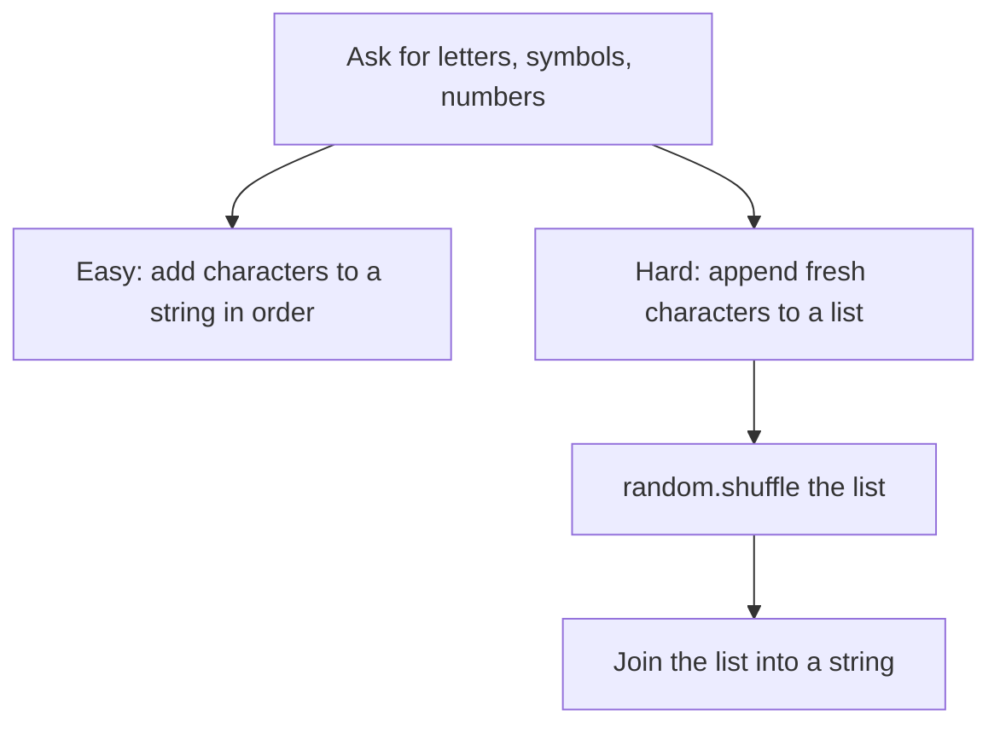

# Day 5 · Python Loops

[← Day 4](../Day%204%20-%20Beginner%20-%20Randomisation%20and%20Python%20Lists/Day%204%20-%20Beginner%20-%20Randomisation%20and%20Python%20Lists.md) · [Roadmap](../../README.md#roadmap) · [Day 6 →](../Day%206%20-%20Beginner%20-%20Python%20Functions%20&%20Karel/Day%206%20-%20Beginner%20-%20Python%20Functions%20&%20Karel.md) <!-- nav -->

## TL;DR

- A **`for`** loop runs its indented block once for each item. The name after `for` is a new name for the current item.
- Code indented under `for` repeats. Code that is back at the left margin runs once, after the loop.
- `range(start, stop)` counts from `start` up to, but not including, `stop`. A third argument is the step.
- An accumulator starts at `0` before the loop. Inside the loop, `total += number` builds the result. The same pattern finds a maximum without calling `max()`.
- FizzBuzz tests "divisible by 3 and 5" before the single tests. Otherwise 15 is printed as `Fizz` and the combined word never runs.

## Learning objectives

By the end of this day you should be able to:

- Loop through a list and do something with each item.
- Tell code inside the loop from code after the loop by the indentation.
- Add up a list with a `for` loop instead of `sum()`.
- Keep a running maximum with a `for` loop instead of `max()`.
- Use `range()` with a stop, and with a step.
- Print FizzBuzz from 1 to 100.
- Build a password from random letters, symbols, and numbers, then shuffle it.

## Lessons

### Day 5 Goals: what we will make by the end of the day

Reusing one password across sites means one leak unlocks the others. The project asks how many letters, symbols, and numbers you want, then builds a password from those counts. A strong password is long and different for each site. `123456` and `qwerty` are not.

### Using the for loop with Python Lists

A `for` loop walks a list from the first item to the last. The name between `for` and `in` is only the current item. It changes on every pass.

```python
fruits = ["apple", "peach", "pear"]
for fruit in fruits:
    print(fruit)
```

That prints three lines: apple, then peach, then pear. Any extra indented line also runs three times. A `print` that sits at the same indent as `for`, underneath the loop, runs once after the last fruit.

The loop variable is an ordinary name. After the loop it still holds the last item.

### Highest Score

`sum(student_scores)` adds a list. The same total can be built by hand. Start at `0`, then add each score:

```python
total = 0
for score in student_scores:
    total += score
```

`max(student_scores)` returns the largest score. [highest_score.py](exercises/highest_score.py) gets that result without calling `max()`. Keep a `highest_score` that starts at `0`. Inside the loop, replace it when the current score is greater. Print `highest_score` after the loop, not inside it, or you will print every new record along the way.

The list in that file adds up to 2068, and its largest score is 199.

### for loops and the range() function

`range` produces a stream of integers. It does nothing visible until a `for` loop asks for each number.

```python
for number in range(1, 10):
    print(number)          # 1 through 9, not 10

for number in range(1, 11):
    print(number)          # 1 through 10

for number in range(1, 11, 3):
    print(number)          # 1, 4, 7, 10
```

`range(start, stop)` stops before `stop`. `range(start, stop, step)` jumps by `step`.

The in-video check is the sum of 1 through 100. Gauss's total is 5050. The stop has to be 101, because 100 must be included:

```python
total = 0
for number in range(1, 101):
    total += number
print(total)               # 5050
```

### Coding Exercise 6: FizzBuzz

[06_fizzbuzz.py](exercises/06_fizzbuzz.py) prints every integer from 1 to 100, including 100.

- Divisible by 3 and by 5: `FizzBuzz`
- Divisible by 3: `Fizz`
- Divisible by 5: `Buzz`
- Otherwise the number itself

The opening of the output is `1`, `2`, `Fizz`, `4`, `Buzz`, `Fizz`, and `15` must be `FizzBuzz`. Test the combined case first. With `if` / `elif`, a true `number % 3 == 0` would skip the later combined test.

### Day 5 Project: Password Generator

See [Project](#project). The easy version builds one string in order: all the letters, then the symbols, then the numbers. The hard version fills its own list with `append` and `random.choice`, calls `random.shuffle` on that list, then joins the characters into a string. The hard password is not a shuffle of the easy string.

## Key concepts

| Concept | Summary |
| --- | --- |
| [Loops](../../concepts/loops.md) | `for`, indentation, `range`, and accumulators |
| [Lists](../../concepts/lists.md) | The collection a `for` loop walks, and the list that gets shuffled |
| [Random](../../concepts/random.md) | `choice` to pick a character, `shuffle` to reorder a list |
| [Modulo](../../concepts/modulo.md) | `n % 3 == 0` and `n % 5 == 0` in FizzBuzz |
| [Conditionals](../../concepts/conditionals.md) | The FizzBuzz chain, and updating a maximum |

## Cheat sheet

```python
fruits = ["apple", "peach", "pear"]
for fruit in fruits:
    print(fruit)

total = 0
for number in range(1, 101):      # 1..100
    total += number

for number in range(1, 11, 3):    # 1, 4, 7, 10
    print(number)

number % 3 == 0 and number % 5 == 0   # both, so this test comes before either one alone
```

## Common pitfalls

| Mistake | What Python says or does | Fix |
| --- | --- | --- |
| `range(1, 100)` for 1 through 100 | The loop stops at 99 | Use `range(1, 101)` |
| Print the total inside the loop | You see every partial sum | Indent `print` with the `for`, not under it |
| `if n % 3 == 0` before the combined test | 15 prints `Fizz` | Test `n % 3 == 0 and n % 5 == 0` first |
| `password = random.shuffle(items)` | `password` is `None` | `shuffle` reorders the list in place and returns `None`. Join the list afterwards |
| `for char in range(1, letters)` when `letters` is already the count you want | One character too few | `range` excludes the stop, so the stop is `count + 1`, or use `range(count)` |
| Loop body not indented | `IndentationError: expected an indented block` | Indent the repeated lines by four spaces |

> [!TIP]
> If a loop seems to run the wrong number of times, print the loop variable on the first line of the body. The last value you see is the last value `range` actually produced.

## Exercises

| # | Exercise | What it practises | Code |
| --- | --- | --- | --- |
| 6 | FizzBuzz | `range`, `%`, and `if`/`elif` order | [06_fizzbuzz.py](exercises/06_fizzbuzz.py) |

Highest Score is the practice inside that lesson, not a separate numbered exercise: [highest_score.py](exercises/highest_score.py). The sum of 1 to 100 is the in-video check in the `range` lesson.

<details>
<summary>Hint for exercise 6</summary>
Loop with range(1, 101). Test divisible by 3 and by 5 first and print FizzBuzz. Then elif for 3 (Fizz) and elif for 5 (Buzz). else prints the number. 15 must be FizzBuzz, not Fizz.
</details>

<details>
<summary>Hint for highest score</summary>
Start max_score at 0 before the loop. For each score, if it is greater than max_score, store that score in max_score. Print max_score once, after the loop. Do not call max().
</details>

## Project

**Password Generator**

- **Goal:** Ask for three counts, then build a password with that many random letters, symbols, and numbers.
- **Easy:** Letters first, then symbols, then numbers. Start from an empty string and add each random character with `+=`.
- **Hard:** A separate list. `append` each `random.choice`, call `random.shuffle` on that list, then build the string. Do not shuffle `easy_password`.
- **Code:** [project/main.py](project/main.py). The hard level:

```python
password_list = []
for _ in range(nr_letters):
    password_list.append(random.choice(letters))
random.shuffle(password_list)
password = ""
for char in password_list:
    password += char
```

- **Run:** `python project/main.py` from this day's folder. It prints `Easy password: ...` and then `Your password is: ...`.



### Ideas to extend it

- Reject a count below 0. A negative `range` stop simply does not loop, so the password would be shorter than asked without any warning.
- Print the length of the finished password next to it, and check it equals the three counts added together.
- Day 29 builds a password manager that can store what this generator creates. That is far ahead of this lesson.

## Recall questions

<details>
<summary>What does <code>for n in range(1, 5): print(n)</code> print?</summary>
1 then 2 then 3 then 4. The stop, 5, is not included.
</details>

<details>
<summary>A print sits under the for line, indented. A second print sits below the whole loop, not indented. How many times does each run if the list has 3 items?</summary>
The indented print runs 3 times. The print after the loop runs once.
</details>

<details>
<summary>Why does the sum from 1 to 100 use <code>range(1, 101)</code>?</summary>
range stops before the second number. 101 makes 100 the last value that is included. The total is 5050.
</details>

<details>
<summary>What does 15 print in FizzBuzz, and why must that test come first?</summary>
FizzBuzz. 15 is divisible by 3 and by 5. An earlier test for 3 alone would print Fizz and skip the combined branch.
</details>

<details>
<summary>What does <code>random.shuffle(items)</code> return?</summary>
None. It reorders items itself. Read items afterwards, or join it into a string. Do not assign the call to the password.
</details>

## Further reading

- [for statements](https://docs.python.org/3/tutorial/controlflow.html#for-statements) in the Python tutorial
- [range](https://docs.python.org/3/library/stdtypes.html#ranges) in the standard types
- [random.shuffle](https://docs.python.org/3/library/random.html#random.shuffle) and [random.choice](https://docs.python.org/3/library/random.html#random.choice)

---

[← Day 4](../Day%204%20-%20Beginner%20-%20Randomisation%20and%20Python%20Lists/Day%204%20-%20Beginner%20-%20Randomisation%20and%20Python%20Lists.md) · [Roadmap](../../README.md#roadmap) · [Day 6 →](../Day%206%20-%20Beginner%20-%20Python%20Functions%20&%20Karel/Day%206%20-%20Beginner%20-%20Python%20Functions%20&%20Karel.md) <!-- nav -->
