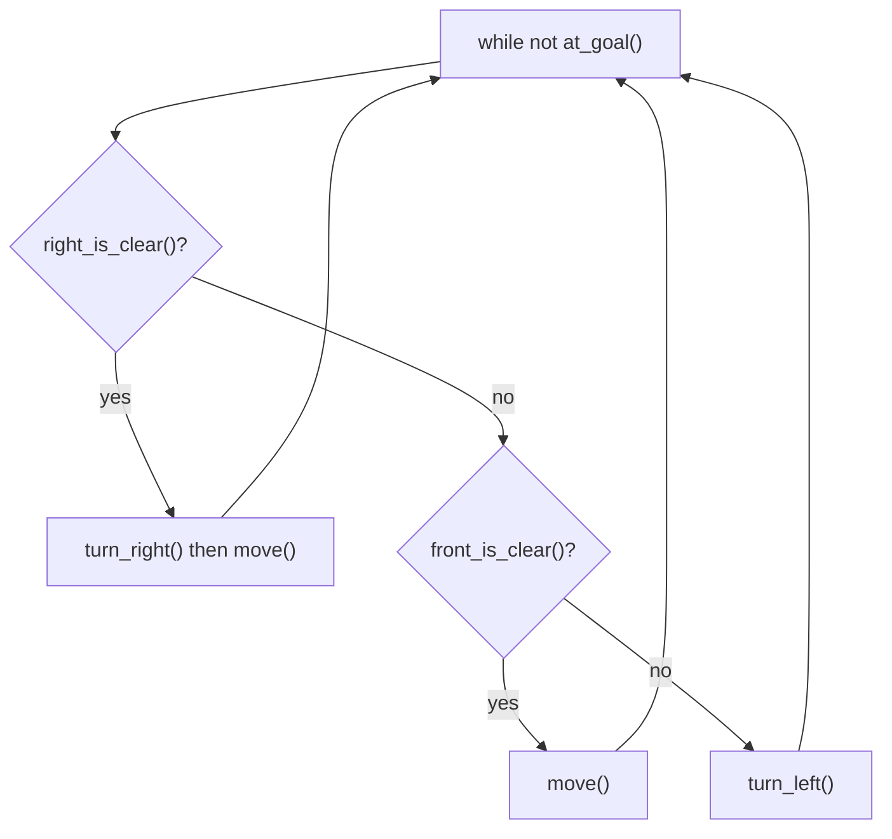

# Day 6 · Python Functions & Karel

[← Day 5](../Day%205%20-%20Beginner%20-%20Python%20Loops/Day%205%20-%20Beginner%20-%20Python%20Loops.md) · [Roadmap](../../README.md#roadmap) · [Day 7 →](../Day%207%20-%20Beginner%20-%20Hangman/Day%207%20-%20Beginner%20-%20Hangman.md) <!-- nav -->

## TL;DR

- `def name():` **defines** a function. Its indented lines run only when the function is **called** with `name()`.
- A function bundles repeated steps under one readable name. `turn_right()` says more than three `turn_left()` lines.
- Indentation decides which block a line belongs to. PEP 8 asks for four spaces per level, and Python 3 refuses to mix tabs and spaces in one file.
- A `while` loop repeats as long as its condition is true. Use `for` when you walk a list or a known range; use `while` when you only know the stopping condition.
- A `while` condition that never becomes false is an **infinite loop**. Print the condition to see why it never changes.

## Learning objectives

By the end of this day you should be able to:

- Tell a built-in function such as `len()` from a function you define with `def`.
- Define a function with no inputs and call it as many times as needed.
- Read nested indentation and say which block each line belongs to.
- Write a `while` loop with a counter, and one with a condition such as `not at_goal()`.
- Choose between a `for` loop and a `while` loop for a task.
- Combine functions, `while`, and `if`/`elif`/`else` to solve a Reeborg's World maze.

## Lessons

### 1. Day 6 Goals: what we will make by the end of the day

The day introduces functions and `while` loops through a robot that only understands a handful of commands. The final project guides that robot through a maze from a random start.

### 2. Defining and Calling Python Functions

Python already ships with built-in functions: `print()`, `len()`, `int()`, `range()`. The parentheses are what mark a name as a function call.

Defining your own function takes two steps. First write the recipe, then use it:

```python
def my_function():       # 1. define: def, name, (), colon
    print("Hello")       #    indented lines are the body
    print("Bye")

my_function()            # 2. call: name and ()
```

Defining alone prints nothing. Python only runs the body when it reaches the call, then jumps back to the line after the call.

The lesson moves to [Reeborg's World](https://reeborg.ca/reeborg.html?lang=en&mode=python&menu=worlds%2Fmenus%2Freeborg_intro_en.json&name=Alone&url=worlds%2Ftutorial_en%2Falone.json), a browser robot in the spirit of Karel the Robot. It understands `move()` and `turn_left()` but has no `turn_right()`. A function fills that gap:

```python
def turn_right():
    turn_left()
    turn_left()
    turn_left()
```

The step button runs one line at a time and highlights the next one. It shows Python jumping into the function body and back out again, which makes it a good debugging tool.

### 3. The Hurdles Loop Challenge

Hurdle 1 has six identical hurdles. Writing every step out takes about 58 lines. Packing one jump into a `jump()` function and calling it from `for step in range(6):` brings that down to a dozen readable lines. Test after every few lines with the step button, so a mistake shows up while the code is still short.

### 4. Indentation in Python

Every line indented under `def`, `if`, `elif`, `else`, or `for` belongs to that block. A line back at the outer margin is outside it.

```python
def my_function():
    print("Hello")       # inside the function
    if sky == "clear":
        print("blue")    # inside the if, inside the function
print("World")           # outside: runs once, even if my_function is never called
```

Think of each block as a folder: the indented lines are files inside it. PEP 8 recommends four spaces per level. Most editors insert four spaces when you press Tab, so you get the convention without counting.

The Udemy section includes an indentation quiz here (multiple choice, no code file).

### 5. While Loops

```python
number_of_hurdles = 6
while number_of_hurdles > 0:
    jump()
    number_of_hurdles -= 1
```

Python tests the condition, runs the body, then goes back and tests again. When `number_of_hurdles` reaches `0`, `0 > 0` is false and the loop ends.

Hurdle 2 places the flag at random, so the number of jumps is unknown. Reeborg offers a condition, `at_goal()`, that is true on the flag:

```python
while not at_goal():
    jump()
```

`not` flips the result, so the loop keeps jumping while the robot is *not* at the goal.

| Use | When |
| --- | --- |
| `for item in items:` | You need each item of a list, or each number of a range |
| `while condition:` | You only know when to stop, not how many passes it takes |

A `for` loop ends at the end of its list or range. A `while` loop ends only when its condition turns false. `while 5 > 3:` never does, so it runs until the program is stopped.

### 6. Hurdles Challenge using While Loops

Hurdle 3 places a random number of walls at random positions. Inside `while not at_goal():`, an `if` decides each step: jump when `wall_in_front()` is true, otherwise `move()`. The old `jump()` started with a `move()`, which now walks into the wall. The fix is to take that first `move()` out of `jump()` and let the `else` branch do the moving.

### 7. Jumping over Hurdles with Variable Heights

Hurdle 4 makes each wall a random height too. A fixed jump no longer works, so `jump()` needs its own `while` loops: climb while `wall_on_right()` is true, step over, then descend while `front_is_clear()`. Reeborg's keyboard window lists every condition, and the spelling there is the spelling Python needs. A missing colon shows up as `invalid syntax`; testing small changes keeps that error easy to find.

### 8. Final Project: Escaping the Maze

See [Project](#project).

### 9. Why is this *so* Hard?! Can I really do this?

A short pep talk: struggling with these challenges is normal. Revisit the material and keep going.

## Key concepts

| Concept | Summary |
| --- | --- |
| [Functions](../../concepts/functions.md) | `def`, calling with `()`, and why named steps make code shorter and clearer |
| [Loops](../../concepts/loops.md) | `while`, `for` versus `while`, and infinite loops |
| [Conditionals](../../concepts/conditionals.md) | `if`/`elif`/`else` choosing the robot's next move |
| [Logical operators](../../concepts/logical-operators.md) | `not at_goal()` reverses a condition |
| [PEP 8](../../concepts/pep-8.md) | Four spaces per indentation level, spaces rather than tabs |

## Cheat sheet

```python
def greet():                 # define
    print("Hello")
    print("Bye")

greet()                      # call
greet()                      # call again: the body runs again

count = 3
while count > 0:             # runs while the condition is true
    print(count)
    count -= 1               # without this line the loop never ends

done = False
while not done:              # same as: while done == False
    done = True
```

## Common pitfalls

| Mistake | What Python says or does | Fix |
| --- | --- | --- |
| `def turn_right:` without `()` | `SyntaxError: invalid syntax` | Write `def turn_right():` |
| Calling `turn_right` without `()` | Nothing happens; the name is only mentioned | Add the parentheses: `turn_right()` |
| Body not indented under `def` | `IndentationError: expected an indented block` | Indent every body line by four spaces |
| A line meant for the function sits at the outer margin | It runs once, outside the function | Indent it to the function's level |
| Calling a function above its `def` | `NameError: name '...' is not defined` | Put the `def` before the first call |
| Forgetting to change the variable in a `while` | The loop never ends | Update the variable inside the body, or print the condition to see it stay true |
| Mixing tabs and spaces | `TabError: inconsistent use of tabs and spaces in indentation` | Set the editor to insert four spaces for Tab |

> [!TIP]
> When a loop never stops, print its condition on the first line of the body. If it prints `True` forever, nothing in the body changes what the condition tests.

## Exercises

Day 6 has no numbered coding exercise. The practice happens in Reeborg's World; the starters hold the brief and run in the browser, not with `python`.

| Challenge | What it practises | Code |
| --- | --- | --- |
| Hurdle 1 | A `jump()` function called from a `for` loop | [hurdle_1.py](exercises/hurdle_1.py) |
| Hurdle 2 | `while not at_goal():` with a random flag | [hurdle_2.py](exercises/hurdle_2.py) |
| Hurdle 3 | `while` with `if wall_in_front():` / `else` | [hurdle_3.py](exercises/hurdle_3.py) |
| Hurdle 4 | `while` loops inside `jump()` for walls of any height | [hurdle_4.py](exercises/hurdle_4.py) |

<details>
<summary>Hint for hurdle 1</summary>
One hurdle is: move, turn left, move, turn right, move, turn right, move, turn left. Put those steps in jump(), then call it from for step in range(6).
</details>

<details>
<summary>Hint for hurdle 3</summary>
Take the first move() out of jump(). Inside while not at_goal(), jump when wall_in_front() is true, else move().
</details>

<details>
<summary>Hint for hurdle 4</summary>
In jump(): turn left, then while wall_on_right(): move(). Turn right, move, turn right, then while front_is_clear(): move(). Finish with turn_left().
</details>

## Project

**Escaping the Maze (Reeborg's World)**

- **Goal:** From a random start square and direction, reach the exit of the [Maze world](https://reeborg.ca/reeborg.html?lang=en&mode=python&menu=worlds%2Fmenus%2Freeborg_intro_en.json&name=Maze&url=worlds%2Ftutorial_en%2Fmaze1.json).
- **Algorithm:** Follow the right-hand wall. Turn right and move if the right is clear. Otherwise move forward if the front is clear. Otherwise turn left. Repeat until `at_goal()`.
- **Code:** [project/main.py](project/main.py) (paste it into Reeborg's World). Core loop:

```python
def turn_right():
    turn_left()
    turn_left()
    turn_left()

while not at_goal():
    if right_is_clear():
        turn_right()
        move()
    elif front_is_clear():
        move()
    else:
        turn_left()
```

- **Run:** In the browser. Click **Play**, or use the step button to watch each line. Reeborg hurdles: [hurdle_1.py](exercises/hurdle_1.py) through [hurdle_4.py](exercises/hurdle_4.py).



> [!NOTE]
> Some starts make the robot circle an open square forever, because its right is always clear. A step count above 1000 is the warning sign. That edge case is optional debugging practice that the course suggests revisiting after Day 15. One fix is to walk forward until a wall is in front, turn left so the wall sits on the right, then start the right-hand loop. The course's three problem worlds (a zip in the lecture resources, loaded with **Open world from file**) reproduce the bad starts.

### Ideas to extend it

- Count the steps the robot takes and `print()` the total when it reaches the goal.
- Try the left-hand rule instead and compare step counts from the same start.
- Load the three problem worlds and make one program that escapes all of them.

## Recall questions

<details>
<summary>What does this print? <code>def hi(): print("hi")</code> on one line, and nothing else in the file.</summary>
Nothing. The function is defined but never called.
</details>

<details>
<summary>Why does <code>turn_right()</code> make the code better, beyond saving lines?</summary>
It names the intent. A reader sees turn_right() and knows the move, instead of decoding three turn_left() calls.
</details>

<details>
<summary>How many times does the body of <code>n = 3; while n > 0: n -= 1</code> run?</summary>
Three times: n goes 3, 2, 1. When n is 0, 0 > 0 is false and the loop ends.
</details>

<details>
<summary>Walk a list of names, or jump until the robot reaches the flag. Which loop fits each?</summary>
A for loop walks the list. A while loop jumps until at_goal() is true, because the number of jumps is unknown.
</details>

<details>
<summary>What turns a <code>while</code> loop into an infinite loop?</summary>
A condition that never becomes false, usually because nothing in the body changes what it tests.
</details>

<details>
<summary>A <code>print</code> sits at the outer margin below a function. When does it run?</summary>
Once, when Python reaches that line. It is not part of the function, so calling the function does not run it.
</details>

## Further reading

- [Defining functions](https://docs.python.org/3/tutorial/controlflow.html#defining-functions) in the Python tutorial
- [while statements](https://docs.python.org/3/reference/compound_stmts.html#the-while-statement) in the language reference
- [Built-in functions](https://docs.python.org/3/library/functions.html)
- [PEP 8: Indentation](https://peps.python.org/pep-0008/#indentation)
- [Learn Python with Reeborg](https://reeborg.ca/docs/en/)

---

[← Day 5](../Day%205%20-%20Beginner%20-%20Python%20Loops/Day%205%20-%20Beginner%20-%20Python%20Loops.md) · [Roadmap](../../README.md#roadmap) · [Day 7 →](../Day%207%20-%20Beginner%20-%20Hangman/Day%207%20-%20Beginner%20-%20Hangman.md) <!-- nav -->
