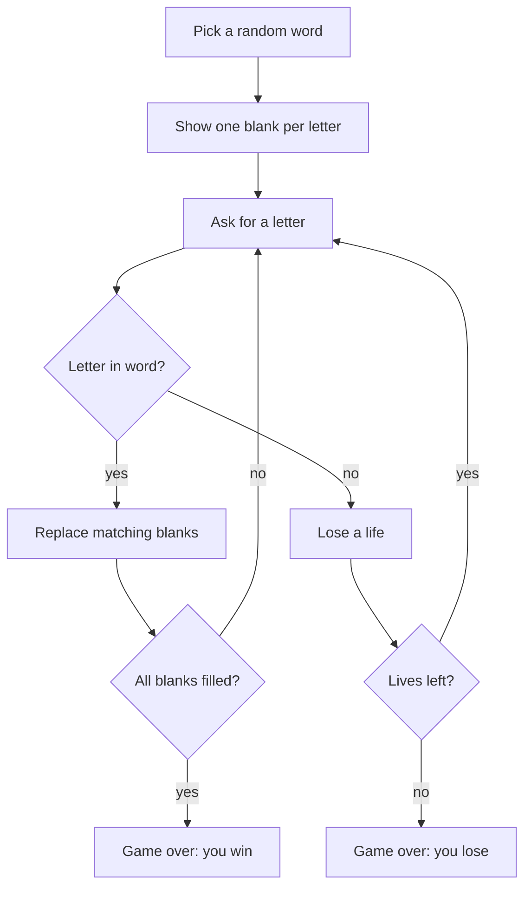

# Day 7 · Hangman

[← Day 6](../Day%206%20-%20Beginner%20-%20Python%20Functions%20&%20Karel/Day%206%20-%20Beginner%20-%20Python%20Functions%20&%20Karel.md) · [Roadmap](../../README.md#roadmap) · [Day 8 →](../Day%208%20-%20Beginner%20-%20Function%20Parameters%20&%20Caesar%20Cipher/Day%208%20-%20Beginner%20-%20Function%20Parameters%20&%20Caesar%20Cipher.md) <!-- nav -->

## TL;DR

- Draw a **flowchart** before coding a bigger program. Each box becomes a small piece of code you can test on its own.
- A `for` loop walks a string one character at a time, just like a list.
- `in` and `not in` check membership: `"_" not in display` means every blank is filled.
- A list that has to remember things across passes of a `while` loop is created *before* the loop. Created inside, it is wiped on every pass.
- `from module import name` brings in one name, so you can write `word_list` instead of `hangman_words.word_list`.

## Learning objectives

By the end of this day you should be able to:

- Break a game into steps with a flowchart.
- Loop through the characters of a string.
- Build a string of blanks with `range(len(word))` and `+=`.
- Keep a game running with a `game_over` flag and a `while not game_over:` loop.
- Use `in` and `not in` to test whether a letter is in a word or a list.
- Import names from your own module with `import` and with `from ... import ...`.

## Lessons

### 1. Day 7 Goals: what we will make by the end of the day

The whole day builds Hangman. The player guesses letters of a hidden word; each wrong letter draws more of the figure. The project reviews loops, `if`/`else`, lists, strings, `range`, and modules. The [demo](https://appbrewery.github.io/python-day7-demo/) shows the finished game.

### 2. How to break a Complex Problem down into a Flow Chart

Before writing code, sketch the logic on paper or in [draw.io](https://app.diagrams.net/). There is no single correct flowchart. A good one answers: what happens first, what happens after a guess, and when the game ends.



### 3. Step 1 - Picking a Random Words and Checking Answers

Pick the word with `random.choice(word_list)`, read a guess with `input(...).lower()`, then compare it with every letter. Lowercasing matters because every word in the list is lowercase, and `"A" == "a"` is `False`.

```python
for letter in chosen_word:     # a string can be looped like a list
    if letter == guess:
        print("Right")
    else:
        print("Wrong")
```

PEP 8 wants imports at the top of the file. The course's starter puts some lower down beside the TODOs; it works the same either way.

### 4. Step 2 - Replacing Blanks with Guesses

Build a placeholder with one `_` per letter. `range(len(chosen_word))` runs exactly once per letter:

```python
placeholder = ""
for position in range(len(chosen_word)):
    placeholder += "_"
```

Then build `display` from the guess: add the letter when it matches, an underscore when it does not. For `apple` and a guess of `p`, `display` is `_pp__`.

### 5. Step 3 - Checking if the Player has Won

A `while not game_over:` loop lets the player keep guessing. Without a way to set `game_over = True`, the loop never ends, so the first exit is the win: `if "_" not in display:`.

A new problem appears: `display` is rebuilt from scratch on every guess, so earlier correct letters vanish. The fix is a `correct_letters` list created *before* the loop. A matching guess is appended to it, and an `elif letter in correct_letters:` branch keeps earlier letters in `display`.

### 6. Step 4 - Keeping Track of the Player's Lives

`lives = 6` before the loop. A separate check keeps the logic easy to read:

```python
if guess not in chosen_word:
    lives -= 1
    if lives == 0:
        game_over = True
        print("You lose.")
```

The art list `stages` is ordered so that `stages[lives]` is the right picture: `stages[6]` is the empty gallows and `stages[0]` is the finished figure.

### 7. Step 5 - Improving the User Experience

The word list and the art move into their own files, `hangman_words.py` and `hangman_art.py`. Two ways to import them:

```python
import hangman_words
hangman_words.word_list           # module name, dot, item

from hangman_art import stages, logo
stages[6]                         # used directly, no prefix
```

The rest is feedback: say when a letter was already guessed (no life lost), say when a guess costs a life, show `lives`/6 after each guess, and reveal the word on a loss.

### 8. The Benefits of Daily Practice

A short reminder that a little practice every day beats occasional long sessions.

## Key concepts

| Concept | Summary |
| --- | --- |
| [Loops](../../concepts/loops.md) | `for` over a string, `range(len(word))`, and `while not game_over` |
| [Strings](../../concepts/strings.md) | Building `display` with `+=`, `.lower()`, and `in` on a string |
| [Lists](../../concepts/lists.md) | `correct_letters` that survives every pass of the loop |
| [Conditionals](../../concepts/conditionals.md) | `if` / `elif` / `else` to choose letter or blank |
| [Random](../../concepts/random.md) | `random.choice(word_list)` |
| [Modules](../../concepts/modules.md) | `import hangman_words` and `from hangman_art import stages, logo` |

## Cheat sheet

```python
for char in "camel":
    print(char)                   # c, a, m, e, l on separate lines

"a" in "camel"                    # True
"z" not in "camel"                # True
"_" not in "c_mel"                # False: one blank left

blanks = ""
for _ in range(len("camel")):
    blanks += "_"                 # "_____"

game_over = False
while not game_over:
    game_over = True              # something inside must end the loop

from random import choice         # import one name from a module
choice(["a", "b"])
```

## Common pitfalls

| Mistake | What Python says or does | Fix |
| --- | --- | --- |
| Comparing an uppercase guess with lowercase words | `"A" == "a"` is `False`, so a right letter counts as wrong | Use `input(...).lower()` |
| `correct_letters = []` inside the `while` loop | Earlier correct letters disappear on every guess | Create the list before the loop |
| No line ever sets `game_over = True` | The game never ends | Set it on a win and when `lives` reaches 0 |
| Subtracting a life inside the `for` loop over the letters | One wrong guess costs several lives | Check `if guess not in chosen_word:` once, outside the `for` |
| `stages[lives]` with art in the wrong order | The figure draws backwards | Keep index 6 empty and index 0 complete |
| `import hangman_words`, then using `word_list` alone | `NameError: name 'word_list' is not defined` | Write `hangman_words.word_list`, or use `from hangman_words import word_list` |

> [!TIP]
> Print `chosen_word` while you build the game. It makes every step testable. Remove the line once everything works.

## Exercises

Day 7 has no separate coding exercise. The five steps of the project are the practice.

<details>
<summary>Hint for step 3</summary>
Create correct_letters = [] before the while loop. When letter == guess, append it. Add an elif letter in correct_letters that also adds the letter to display.
</details>

<details>
<summary>Hint for step 4</summary>
After the for loop that builds display, check if guess not in chosen_word. Subtract one life there, and set game_over when lives reaches 0. Print stages[lives] at the end of every pass.
</details>

## Project

**Hangman**

- **Goal:** Guess the hidden word before six wrong letters complete the figure.
- **How it works:** See the flowchart in the second lesson. Every pass of the loop reads one guess, rebuilds `display`, checks for a win, then checks for a lost life.
- **Code:** [project/main.py](project/main.py). Helpers: [hangman_words.py](project/hangman_words.py) (`word_list`), [hangman_art.py](project/hangman_art.py) (`stages`, `logo`). The loop keeps a `guessed_letters` list so repeats cost nothing, rebuilds `display` after each hit, and ends with `You win.` or the `IT WAS … YOU LOSE` line.
- **Run:** `python project/main.py` from this day's folder. Python finds the two helper files because they sit beside `main.py`.

> [!NOTE]
> The [demo](https://appbrewery.github.io/python-day7-demo/) shows `Word to guess:`, the lives line `4/6 LIVES LEFT` framed by asterisks, and `IT WAS <word>! YOU LOSE` on a loss.

### Ideas to extend it

- Reject input that is not a single letter, and ask again without costing a life.
- Also remember wrong guesses, so a repeated wrong letter does not cost a second life.
- Let the player choose a difficulty that sets the starting lives.

## Recall questions

<details>
<summary>What does <code>for c in "hi": print(c)</code> print?</summary>
h on one line, then i on the next.
</details>

<details>
<summary>Why must <code>correct_letters</code> be created before the <code>while</code> loop?</summary>
Code inside the loop runs on every pass. Creating the list there would empty it on every guess, so earlier correct letters would be lost.
</details>

<details>
<summary>What does <code>"_" not in display</code> tell you in Hangman?</summary>
That no blanks are left, so every letter has been guessed and the player has won.
</details>

<details>
<summary>After <code>import hangman_words</code>, how do you reach the list? And after <code>from hangman_words import word_list</code>?</summary>
hangman_words.word_list in the first case. Just word_list in the second.
</details>

<details>
<summary>The player has 2 lives left. Which picture prints, and why does that work?</summary>
stages[2]. The list is ordered so that each index matches the number of lives left.
</details>

## Further reading

- [Modules](https://docs.python.org/3/tutorial/modules.html) in the Python tutorial
- [Membership tests: in and not in](https://docs.python.org/3/reference/expressions.html#membership-test-operations)
- [Hangman (game)](https://en.wikipedia.org/wiki/Hangman_(game)) on Wikipedia
- [draw.io](https://app.diagrams.net/) for flowcharts

---

[← Day 6](../Day%206%20-%20Beginner%20-%20Python%20Functions%20&%20Karel/Day%206%20-%20Beginner%20-%20Python%20Functions%20&%20Karel.md) · [Roadmap](../../README.md#roadmap) · [Day 8 →](../Day%208%20-%20Beginner%20-%20Function%20Parameters%20&%20Caesar%20Cipher/Day%208%20-%20Beginner%20-%20Function%20Parameters%20&%20Caesar%20Cipher.md) <!-- nav -->
