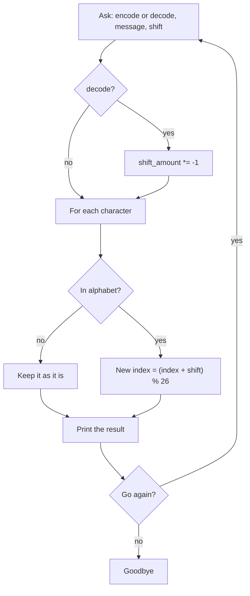

# Day 8 · Function Parameters & Caesar Cipher

[← Day 7](../Day%207%20-%20Beginner%20-%20Hangman/Day%207%20-%20Beginner%20-%20Hangman.md) · [Roadmap](../../README.md#roadmap) · [Day 9 →](../Day%209%20-%20Beginner%20-%20Dictionaries,%20Nesting%20and%20the%20Secret%20Auction/Day%209%20-%20Beginner%20-%20Dictionaries,%20Nesting%20and%20the%20Secret%20Auction.md) <!-- nav -->

## TL;DR

- A function can take inputs. The name in the `def` line is the **parameter**; the value passed in the call is the **argument**.
- With several parameters, **positional** arguments are matched by order. Swap them and the values land in the wrong parameters.
- **Keyword** arguments name each parameter (`greet_with(location="London", name="Angela")`), so their order no longer matters.
- `list.index(item)` returns the position of an item. `% len(alphabet)` wraps a position that runs past the end back to the start.
- Encoding and decoding differ only in the direction of the shift. Multiplying the shift by `-1` once turns one into the other.

## Learning objectives

By the end of this day you should be able to:

- Define a function with one or more parameters and call it with arguments.
- Explain the difference between a parameter and an argument.
- Call a function with positional arguments and with keyword arguments.
- Find an item's position in a list with `.index()`.
- Keep a shifted index inside a list with the modulo operator.
- Build the Caesar cipher as a single function that both encodes and decodes.

## Lessons

### 1. Day 8 Goals: what we will make by the end of the day

The project is the Caesar cipher, an ancient way of hiding a message by shifting every letter a fixed number of places. Sender and receiver agree on the shift; anyone without it sees nonsense. The [demo](https://appbrewery.github.io/python-day8-demo/) encodes and decodes in a loop.

### 2. Functions with Inputs

A function with no inputs does the same thing every time. A parameter lets each call vary:

```python
def greet_with_name(name):
    print(f"Hello {name}")
    print(f"How do you do {name}?")

greet_with_name("Angela")
greet_with_name("Jack Bauer")
```

When `greet_with_name("Angela")` runs, Python effectively sets `name = "Angela"` inside the function.

| Term | What it is | In the example |
| --- | --- | --- |
| Parameter | The name used inside the function | `name` |
| Argument | The actual value passed in the call | `"Angela"` |

Online answers sometimes mix up the two words; the distinction above is the standard one.

### 3. Coding Exercise 7: Life in Weeks

[07_life_in_weeks.py](exercises/07_life_in_weeks.py) takes an age and prints how many weeks remain until 90, such as `You have 1768 weeks left.` for 56. The checker compares text exactly, full stop included. Udemy exercises have no console, so call the function with a fixed age.

### 4. Positional vs. Keyword Arguments

Separate parameters with commas. Positional arguments are matched left to right:

```python
def greet_with(name, location):
    print(f"Hello {name}")
    print(f"What is it like in {location}?")

greet_with("Jack Bauer", "Nowhere")     # correct
greet_with("Nowhere", "Jack Bauer")     # "Hello Nowhere" — order matters
greet_with(location="London", name="Angela")   # keyword arguments: any order
```

Keyword arguments are clearer and harder to get wrong, at the cost of longer lines. Positional arguments are the default; use judgement.

### 5. Coding Exercise 8: Love Calculator

[08_love_calculator.py](exercises/08_love_calculator.py) counts how often the letters of TRUE appear in both names, then the letters of LOVE, and prints the two totals side by side as one number. `"Kanye West"` and `"Kim Kardashian"` give `42`. Lowercase both names first so `T` and `t` count the same.

### 6. Caesar Cipher Part 1 - Encryption

Big problems become manageable when they are split into small ones, so the cipher is built in three parts. The first is `encrypt(original_text, shift_amount)`:

1. Loop over each letter.
2. `alphabet.index(letter)` gives its position, for example `7` for `h`.
3. Add the shift and read the new letter: `alphabet[7 + 2]` is `j`.
4. Add it to a result string created *before* the loop, and print the result after the loop.

Shifting `z` (index 25) by 9 asks for index 34 and raises `IndexError: list index out of range`. Modulo fixes it: `34 % 26` is `8`, which is `i`. `shifted_position %= len(alphabet)` keeps every position between 0 and 25.

### 7. Caesar Cipher Part 2 - Decryption

`decrypt` is `encrypt` with `-` instead of `+`. Modulo handles negative positions too: `a` shifted back by 2 wraps to `y`. Two near-identical functions are a sign to merge them:

```python
def caesar(original_text, shift_amount, encode_or_decode):
    if encode_or_decode == "decode":
        shift_amount *= -1
    # one loop that always adds shift_amount
```

Naming the parameter `direction` would clash with the global variable of the same name. It still runs, but PyCharm warns that it *shadows* the outer name, and readers get confused. Printing `f"Here's the {encode_or_decode}d result: ..."` produces "encoded" or "decoded" from the same line.

### 8. Caesar Cipher Part 3 - Reorganising our Code

Three finishing touches:

- `import art` and `print(art.logo)`.
- Leave characters that are not in `alphabet` (spaces, digits, symbols) unchanged: `if letter not in alphabet:` adds them as they are.
- Wrap the questions and the call in `while should_continue:`, then ask whether to go again; `"no"` sets the flag to `False` and prints `Goodbye`.

Repeated testing exposes a bug: `shift_amount *= -1` inside the `for` loop flips the sign on every letter, so decoding `cd` with shift 2 gives the wrong text. Moving that line above the loop fixes it.

### 9. How You Can *Stay* Motivated

A short note on keeping momentum through the harder days.

## Key concepts

| Concept | Summary |
| --- | --- |
| [Functions](../../concepts/functions.md) | Parameters, arguments, positional and keyword arguments |
| [Lists](../../concepts/lists.md) | `.index()` to find a position |
| [Modulo](../../concepts/modulo.md) | `% len(alphabet)` wraps an index round to the start |
| [Loops](../../concepts/loops.md) | Building the result string letter by letter, and `while should_continue` |
| [Modules](../../concepts/modules.md) | `import art`, then `art.logo` |

## Cheat sheet

```python
def greet_with(name, location):          # two parameters
    print(f"Hello {name} from {location}")

greet_with("Angela", "London")           # positional arguments
greet_with(location="London", name="Angela")   # keyword arguments

fruits = ["apple", "pear", "orange"]
fruits.index("pear")                     # 1

34 % 26                                  # 8: wraps past the end
-2 % 26                                  # 24: wraps below the start

shift = 3
shift *= -1                              # -3: same as shift = shift * -1
```

## Common pitfalls

| Mistake | What Python says or does | Fix |
| --- | --- | --- |
| Calling `greet_with("Angela")` with one argument missing | `TypeError: greet_with() missing 1 required positional argument: 'location'` | Pass one argument per parameter |
| Swapping positional arguments | No error, but the values land in the wrong parameters | Match the `def` order, or use keyword arguments |
| `alphabet[25 + 9]` | `IndexError: list index out of range` | Use `% len(alphabet)` on the new position |
| `shift_amount *= -1` inside the `for` loop | The sign flips on every letter, so decoding is wrong | Flip it once, before the loop |
| Result string created inside the loop | Only the last letter is kept | Create it before the loop |
| `alphabet.index(" ")` for a space or digit | `ValueError: ... is not in list` | Check `if letter not in alphabet:` first |

> [!TIP]
> Test the cipher with a single letter and a small shift, such as `a` and `2`. The expected answer is easy to work out by hand, so a wrong result stands out at once.

## Exercises

| # | Exercise | What it practises | Code |
| --- | --- | --- | --- |
| 7 | Life in Weeks | One parameter, arithmetic, an exact f-string | [07_life_in_weeks.py](exercises/07_life_in_weeks.py) |
| 8 | Love Calculator | Two parameters, `.lower()`, counting letters | [08_love_calculator.py](exercises/08_love_calculator.py) |

<details>
<summary>Hint for exercise 7</summary>
Years left is 90 minus age. Multiply by 52 for weeks. Print with an f-string: You have {weeks} weeks left.
</details>

<details>
<summary>Hint for exercise 8</summary>
Join the names and lowercase them. Add up text.count(letter) for t, r, u, e, then for l, o, v, e. Join the two totals as strings, for example str(true) + str(love), and print it.
</details>

## Project

**Caesar Cipher**

- **Goal:** Encode or decode a message with an agreed shift, and repeat until the user says no.
- **How it works:**



- **Code:** [project/main.py](project/main.py). `caesar()` flips the shift once when decoding, wraps with `% len(alphabet)`, and keeps spaces and symbols. The loop reprints the logo questions until the answer is `no`, then prints `Goodbye`. [project/art.py](project/art.py) holds `logo`.
- **Run:** `python project/main.py` from this day's folder.

> [!NOTE]
> The [demo](https://appbrewery.github.io/python-day8-demo/) prints `Here's the encoded result: ...` or `Here's the decoded result: ...`, then asks `Type 'yes' if you want to go again. Otherwise type 'no'.`

### Ideas to extend it

- Keep uppercase letters uppercase instead of lowercasing the whole message.
- Reject a shift that is not a number and ask again.
- Write a brute-force decoder that prints all 25 possible shifts of a message.

## Recall questions

<details>
<summary>In <code>def greet(name):</code> and <code>greet("Ana")</code>, which is the parameter and which is the argument?</summary>
name is the parameter. "Ana" is the argument.
</details>

<details>
<summary>What does <code>greet_with("Paris", "Ana")</code> print if the parameters are <code>(name, location)</code>?</summary>
Hello Paris, then a question about Ana. Positional arguments follow the order of the parameters, not their meaning.
</details>

<details>
<summary>Why does keyword-argument order not matter?</summary>
Each argument names its parameter, so Python matches them by name instead of by position.
</details>

<details>
<summary>What is <code>(25 + 9) % 26</code>, and why does the cipher need it?</summary>
8. Without the modulo, index 34 is past the end of a 26-letter list and raises IndexError. The modulo wraps it round to the start.
</details>

<details>
<summary>How does multiplying by <code>-1</code> let one function both encode and decode?</summary>
Adding a negative shift is the same as subtracting it. Flip the sign once when decoding and the same addition shifts letters backwards.
</details>

## Further reading

- [Defining functions](https://docs.python.org/3/tutorial/controlflow.html#defining-functions) and [keyword arguments](https://docs.python.org/3/tutorial/controlflow.html#keyword-arguments) in the Python tutorial
- [list.index](https://docs.python.org/3/tutorial/datastructures.html#more-on-lists)
- [Caesar cipher](https://en.wikipedia.org/wiki/Caesar_cipher) on Wikipedia

---

[← Day 7](../Day%207%20-%20Beginner%20-%20Hangman/Day%207%20-%20Beginner%20-%20Hangman.md) · [Roadmap](../../README.md#roadmap) · [Day 9 →](../Day%209%20-%20Beginner%20-%20Dictionaries,%20Nesting%20and%20the%20Secret%20Auction/Day%209%20-%20Beginner%20-%20Dictionaries,%20Nesting%20and%20the%20Secret%20Auction.md) <!-- nav -->
