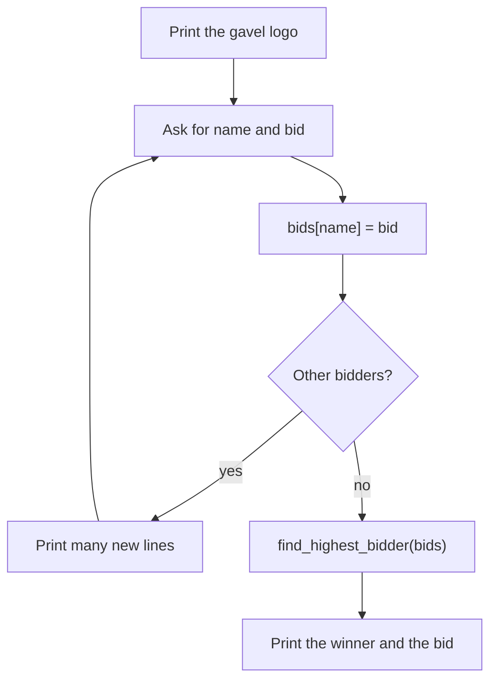

# Day 9 · Dictionaries, Nesting and the Secret Auction

[← Day 8](../Day%208%20-%20Beginner%20-%20Function%20Parameters%20&%20Caesar%20Cipher/Day%208%20-%20Beginner%20-%20Function%20Parameters%20&%20Caesar%20Cipher.md) · [Roadmap](../../README.md#roadmap) · [Day 10 →](../Day%2010%20-%20Beginner%20-%20Functions%20with%20Outputs/Day%2010%20-%20Beginner%20-%20Functions%20with%20Outputs.md) <!-- nav -->

## TL;DR

- A **dictionary** stores **key: value** pairs inside `{}`. You look a value up by its key, `d["Bug"]`, not by a position.
- `d[key] = value` adds a new entry, or replaces the value when the key already exists. `d = {}` empties it.
- A missing key raises `KeyError`. Check the spelling and the type of the key: `"1"` and `1` are different keys.
- `for key in d:` gives the **keys**. Read each value with `d[key]`.
- Lists and dictionaries can be **nested**. Read inner items with one bracket per level: `travel_log["Germany"]["cities_visited"][2]`.

## Learning objectives

By the end of this day you should be able to:

- Create a dictionary, read a value by key, and add or edit entries.
- Explain and fix a `KeyError`.
- Loop through a dictionary and use each key to reach its value.
- Build a new dictionary from an existing one inside a loop.
- Read and write nested lists and dictionaries.
- Build the Secret Auction, storing bids in a dictionary and finding the winner with a loop.

## Lessons

### 1. Day 9 Goals: what we will make by the end of the day

The project is a silent (blind) auction: each bidder enters a name and a bid in turn, the screen is cleared so the next person cannot see it, and the highest bid wins at the end. The [demo](https://appbrewery.github.io/python-day9-demo/) shows the flow.

### 2. The Python Dictionary: Deep Dive

A dictionary works like a real dictionary, or a two-column table: the **key** is the word, the **value** is its definition.

```python
programming_dictionary = {
    "Bug": "An error in a program that prevents it from running as expected.",
    "Function": "A piece of code that you can easily call over and over again.",
}
```

By convention, a long dictionary puts one entry per line, indented, each ending with a comma (the last one too). Adding another entry is then just a new line.

```python
programming_dictionary["Bug"]                 # read a value by its key
programming_dictionary["Loop"] = "Repeating an action."   # add an entry
programming_dictionary["Bug"] = "A moth in your computer."  # edit an entry
empty = {}                                     # an empty dictionary
programming_dictionary = {}                    # wipe an existing one
```

A typo in a key (`"Bog"`) raises `KeyError: 'Bog'`, the dictionary version of a list's `IndexError`. Keys also need the right type: writing `Bug` without quotes makes Python look for a variable called `Bug`.

Looping over a dictionary surprises many beginners:

```python
for key in programming_dictionary:
    print(key)                          # the key only
    print(programming_dictionary[key])  # the value, looked up by key
```

### 3. Coding Exercise 9: Grading Program

[09_grading_program.py](exercises/09_grading_program.py) turns a dictionary of scores into a dictionary of grades: 91 to 100 is `Outstanding`, 81 to 90 `Exceeds Expectations`, 71 to 80 `Acceptable`, and 70 or lower `Fail`. Start with `student_grades = {}`, loop over the student names, and add one entry per student.

### 4. Nesting Lists and Dictionaries

A key can only hold one value, but that value can be a list or another dictionary:

```python
travel_log = {
    "France": ["Paris", "Lille", "Dijon"],
}
travel_log["France"][1]           # "Lille": key first, then index

nested_list = ["A", "B", ["C", "D"]]
nested_list[2][1]                 # "D"

travel_log = {
    "Germany": {
        "num_times_visited": 5,
        "cities_visited": ["Berlin", "Hamburg", "Stuttgart"],
    },
}
travel_log["Germany"]["cities_visited"][2]   # "Stuttgart"
```

Work from the outside in: each pair of brackets unwraps one layer. Printing each step (`travel_log["Germany"]`, then add the next key) shows where you are.

The Udemy section includes a dictionaries quiz here (multiple choice, no code file).

### 5. The Secret Auction Program Instructions and Flow Chart

See [Project](#project). The lesson starts from a flowchart, turns each box into a TODO, then fills the TODOs in one at a time.

### 6. Motivation and the Accountability Trick

Telling someone what you plan to do makes it easier to follow through.

## Key concepts

| Concept | Summary |
| --- | --- |
| [Dictionaries](../../concepts/dictionaries.md) | Key-value pairs, adding, editing, looping, and nesting |
| [Lists](../../concepts/lists.md) | Lists stored as dictionary values, and lists inside lists |
| [Functions](../../concepts/functions.md) | `find_highest_bidder(bidding_dictionary)` takes the dictionary as an argument |
| [Loops](../../concepts/loops.md) | `while continue_bidding:` and a running maximum over the bids |
| [Errors and debugging](../../concepts/errors-and-debugging.md) | `KeyError` when a key does not exist |

## Cheat sheet

```python
ages = {"Ana": 30, "Ben": 25}     # create
ages["Ana"]                       # 30: read
ages["Cy"] = 41                   # add
ages["Ben"] = 26                  # edit
len(ages)                         # 3

for name in ages:                 # keys
    print(name, ages[name])       # key and value

scores = {}                       # empty, ready to fill in a loop

log = {"France": {"cities": ["Paris", "Lille"]}}
log["France"]["cities"][0]        # "Paris"

print("\n" * 100)                 # push old text off the screen
```

## Common pitfalls

| Mistake | What Python says or does | Fix |
| --- | --- | --- |
| A misspelled key, `d["Bog"]` | `KeyError: 'Bog'` | Copy the key exactly; check case and spaces |
| Keys without quotes in the literal, `{Bug: "..."}` | `NameError: name 'Bug' is not defined` | Quote string keys: `{"Bug": "..."}` |
| `d[1]` when the key was stored as `"1"` | `KeyError: 1` | Use the same type when storing and reading |
| Expecting `for x in d:` to give values | You get keys | Use `d[x]` to read the value |
| Creating `bids = {}` inside the `while` loop | Only the last bid survives | Create it before the loop |
| Storing the bid without `int()` | `"9" > "10"` is `True`, so the wrong bidder wins | Convert with `int(input(...))` |
| Calling a function above its `def` | `NameError` | Define the function before the loop that uses it |

> [!TIP]
> When a nested lookup fails, print one layer at a time. The first print that does not show what you expected is the layer with the wrong key or index.

## Exercises

| # | Exercise | What it practises | Code |
| --- | --- | --- | --- |
| 9 | Grading Program | Looping over a dictionary, adding entries, `if`/`elif`/`else` | [09_grading_program.py](exercises/09_grading_program.py) |

<details>
<summary>Hint for exercise 9</summary>
Create student_grades = {} first. Loop for student in student_scores, read score = student_scores[student], then set student_grades[student] to the grade chosen by if/elif/else, highest band first.
</details>

## Project

**Secret Auction**

- **Goal:** Collect bids one person at a time without anyone seeing earlier bids, then announce the highest.
- **How it works:**



- **Code:** [project/main.py](project/main.py). Bids live in a dictionary created before the loop. `yes` prints blank lines and asks again. `no` calls `find_highest_bidder()`, which walks the dictionary and prints the winner. [project/art.py](project/art.py) holds `logo`.
- **Run:** `python project/main.py` from this day's folder.

> [!NOTE]
> Python's `max(bids, key=bids.get)` returns the key with the largest value in one line. The course shows it but recommends the loop first: it is code you can explain line by line.

### Ideas to extend it

- Announce a tie when two people bid the same highest amount.
- Accept bids with cents by using `float()`, and format the winning bid with two decimals.
- Re-ask when someone types a name that has already bid.

## Recall questions

<details>
<summary>How do you read and change the value stored under the key <code>"Bug"</code>?</summary>
Read it with d["Bug"]. Change it with d["Bug"] = new_value. The same syntax adds the key if it does not exist yet.
</details>

<details>
<summary>What does <code>for k in {"a": 1, "b": 2}: print(k)</code> print?</summary>
a and then b. Looping over a dictionary gives its keys.
</details>

<details>
<summary>What causes <code>KeyError</code>, and how is it like <code>IndexError</code>?</summary>
Asking for a key that is not in the dictionary. IndexError is the list version: asking for a position that does not exist.
</details>

<details>
<summary>How do you print <code>"D"</code> from <code>["A", "B", ["C", "D"]]</code>?</summary>
items[2][1]. Index 2 is the inner list, and index 1 inside it is "D".
</details>

<details>
<summary>Why must the <code>bids</code> dictionary be created before the auction loop?</summary>
Code inside the loop runs once per bidder. Creating the dictionary there would empty it each time, losing every earlier bid.
</details>

## Further reading

- [Dictionaries](https://docs.python.org/3/tutorial/datastructures.html#dictionaries) in the Python tutorial
- [Mapping types: dict](https://docs.python.org/3/library/stdtypes.html#mapping-types-dict)
- [max()](https://docs.python.org/3/library/functions.html#max) and its `key` argument

---

[← Day 8](../Day%208%20-%20Beginner%20-%20Function%20Parameters%20&%20Caesar%20Cipher/Day%208%20-%20Beginner%20-%20Function%20Parameters%20&%20Caesar%20Cipher.md) · [Roadmap](../../README.md#roadmap) · [Day 10 →](../Day%2010%20-%20Beginner%20-%20Functions%20with%20Outputs/Day%2010%20-%20Beginner%20-%20Functions%20with%20Outputs.md) <!-- nav -->
