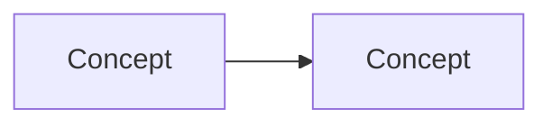

---
tags:
  - review
covers: "Days X-Y"
created: {{date}}
---

# {{title}}

## Big picture

<!-- What this block of days was about and how it builds on the previous one. -->

## Concepts covered

| Concept | Days | Note |
| --- | --- | --- |
|  |  |  |

## How the pieces connect



## Cumulative cheat sheet

```python

```

## Mixed recall questions

<!-- Questions that combine topics from different days. Plain-text answers. -->

<details>
<summary>Question?</summary>
Answer.
</details>

## Practice project

<!-- A small project that uses most of the concepts above. -->
